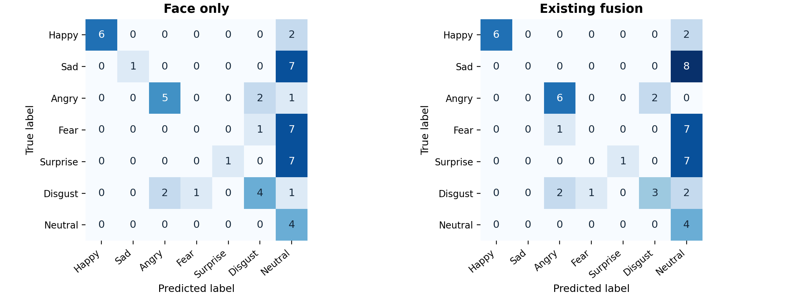
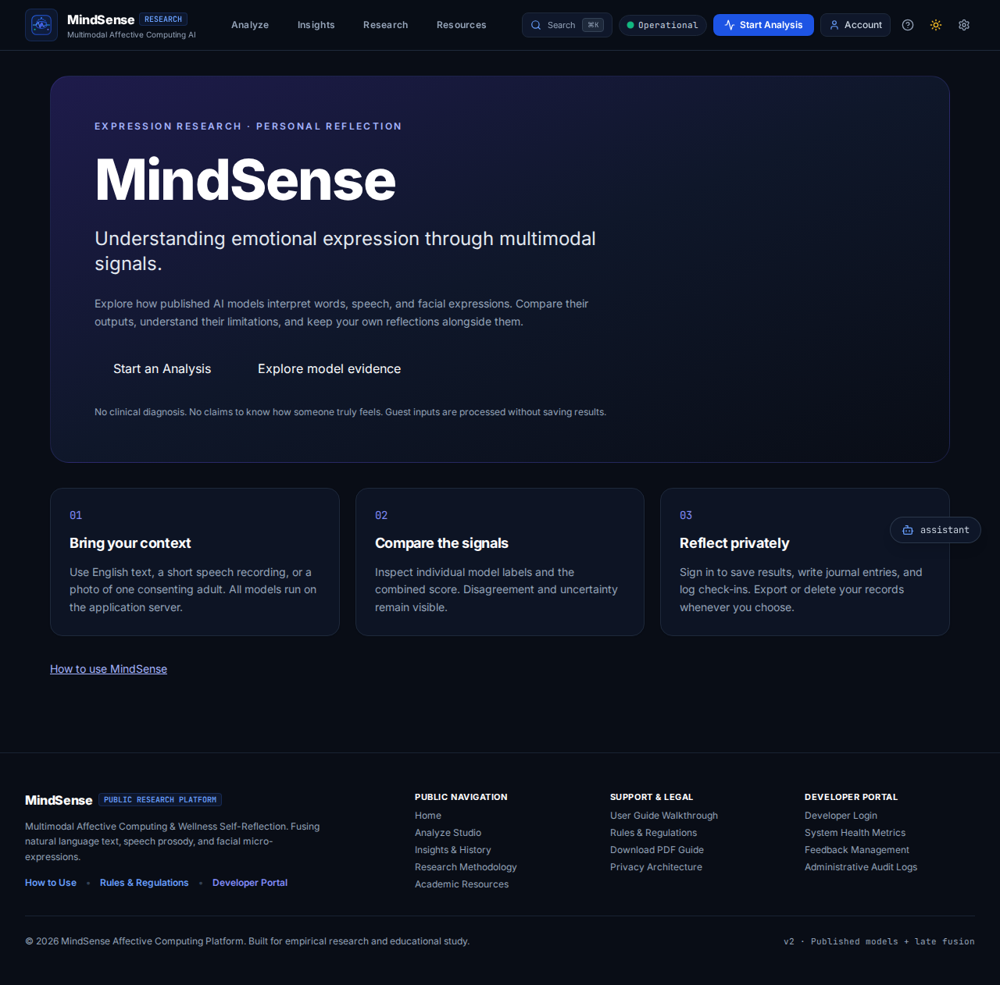

# MindSense multimodal emotion recognition

Academic report on implementation and fusion evaluation

16 November 2026

## Abstract

MindSense is a research demonstration that combines published text, speech and facial-expression classifiers through late fusion. This report examines the implemented system, its evaluation evidence and a specific failure of audiovisual fusion. It evaluates the strength of the available evidence without treating expression labels as clinical assessments.

Arithmetic verification of the committed prediction records confirms 43.72% accuracy and 0.270 macro F1 for text on 2,610 MELD test utterances. The majority-neutral baseline reaches 48.12% accuracy. On 52 eligible audiovisual clips from RAVDESS Actor 01, face-only classification reaches 40.38% accuracy and 0.392 macro F1; the existing fusion reaches 38.46% and 0.355. Fusion changes four face-only decisions, correcting one error and introducing two. Speech is evaluated separately on its 28 supported-class clips and cannot be compared directly with the seven-class results.

Analysis of the serving code identifies a label-support mismatch: audio produces four classes, while face produces seven. Averaging over a different number of modalities for different classes changes the allocation of normalized scores. This is a testable engineering concern, but the available labels alone do not establish it as the cause of the observed accuracy loss.

An actor-disjoint follow-up protocol is committed. Its supplied progress summary reports a modest improvement on Actors 05 and 06, but the corresponding prediction scores, implementation and fitted parameters are absent from the inspected revision. These figures are therefore retained as provisional. The supported contribution is an integration and evidence audit, with a controlled fusion hypothesis. Algorithmic novelty, broad superiority and clinical validity are not established.

## Evidence status

| Evidence | Status in this report |
| --- | --- |
| Serving implementation | Inspected at commit 03fc2fd978adc071bb8685c1216bd4a03911da0e |
| MELD and Actor 01 metrics | Recomputed from committed prediction labels; no new model inference |
| Actor 02 to 06 follow-up | Frozen protocol verified; numerical results supplied in the handoff remain provisional |
| Browser and regression checks | CI logs and screenshot artifact recovered for the inspected commit |

The report addresses three questions: what the application implements, what can explain the fusion failure, and what evidence would be sufficient to support an improvement. Verified findings and provisional follow-up results are presented separately throughout.

<!-- PAGEBREAK -->

## 1 Related work and project contribution

Multimodal emotion recognition combines evidence from channels such as speech and facial expression. RAVDESS provides controlled acted audiovisual material [1]; MELD provides conversational text, audio and video [2]. They differ in collection setting and task structure, so results on one should not be interpreted as performance on the other. MindSense uses only MELD text in its verified MELD experiment.

Temperature scaling is an established post-processing approach to confidence calibration [3]. COLD Fusion learns modality-specific latent distributions and constrains their uncertainty through calibration and ordinal ranking [4]. Its audiovisual uncertainty modelling is materially different from a score-level adapter around frozen classifiers. The proposed MindSense investigation neither implements nor directly compares against COLD Fusion. Referencing that work establishes prior art, not an empirical baseline.

The concrete project contribution is integration of pinned published models, explicit label mapping, a transparent serving rule and traceable evaluation. A future evaluated fusion adapter could be an engineering contribution. A better result on two actors would not by itself establish a new algorithm or a general advantage over established methods.

## 2 Implemented system

The React frontend sends requests to a FastAPI backend. The inference service loads local model files, preprocesses the supplied modalities, obtains classifier scores and combines them. A model lock serializes inference within the supported single process. The active API does not instantiate the older cross-attention research network [R1, R2].

| Input | Published model | Serving interpretation |
| --- | --- | --- |
| English text | SamLowe/roberta-base-go_emotions | Sigmoid outputs grouped into seven labels using group maxima, then normalized |
| Speech at 16 kHz | superb/wav2vec2-base-superb-er | Softmax scores for happy, sad, angry and neutral |
| One facial image | trpakov/vit-face-expression | Softmax scores for seven expression classes after face detection and cropping |

The model cards describe GoEmotions, IEMOCAP/SUPERB and FER2013 as the respective task data [5-7]. Their published metrics are not substituted for MindSense measurements. The serving registry pins exact revisions, reproduced in Appendix A.

Text is limited to the first 256 tokens. Audio is decoded to 16 kHz and accepted between 0.1 and 30 seconds. Facial analysis requires exactly one detectable frontal face. These constraints affect coverage and should be reported alongside accuracy.

Guest results are returned without saving them. Authenticated history stores result metadata and scores; the architecture documents separate private journaling, check-ins, export and deletion. The application does not persist raw analysis text, photographs or recordings. This does not mean that journal entries are never stored. SQLite lacks application-level encryption, and browser bearer tokens use localStorage [R2].

<!-- PAGEBREAK -->

## 3 Fusion mathematics and failure hypothesis

Let L contain happy, sad, angry, fear, surprise, disgust and neutral. Let S be the audio-supported subset containing happy, sad, angry and neutral, and let U = L minus S. Write a(k) for normalized audio scores on S and b(k) for normalized face scores on L.

The serving rule averages each label only across modalities that expose that label and then normalizes the resulting vector [R1]. With audio and face present, the pre-normalization score is:

    r(k) = (a(k) + b(k)) / 2     for k in S
    r(k) = b(k)                  for k in U

Define u = sum of b(k) over U. Since audio sums to one over S and face sums to one over L, the normalization constant and final score are:

    Z = 1 + u / 2
    p(k) = r(k) / Z
    sum over U of p(k) = u / (1 + u / 2)

For 0 < u <= 1, the final unsupported-class mass is lower than the face-only mass u. Normalizing the vector does not preserve the original allocation across the supported and unsupported groups. This is a structural property of the code, independent of dataset performance. It also differs from zero-padding audio to seven labels and taking an ordinary equal-weight mixture, which would assign total unsupported mass u/2.

As a constructed arithmetic illustration, take face scores happy = 0.55 and fear = 0.45, and audio happy = 1. The legacy rule assigns fear 0.45/1.225, approximately 0.3673. This illustration is not a model prediction or performance measurement.

### A comparator that preserves mass

A candidate comparator can preserve the face model's total mass on unsupported classes while allowing audio to redistribute only the supported mass. For a fixed weight w between zero and one:

    q(k) = b(k)                                  for k in U
    q(k) = (1-w)b(k) + w(1-u)a(k)                 for k in S

The scores remain non-negative and sum to one. At w = 0 this is face-only classification. At w = 1, audio distributes the supported mass 1-u. The formula remains defined when u = 1. This report proposes the expression as a transparent comparator; it does not assert that it is the missing follow-up implementation or that it improves accuracy.

The assumption is consequential: the face model is trusted to allocate mass between S and U. If that allocation is wrong, preservation can retain the error. Temperature scaling and reliability weighting introduce additional choices that require development data. A mechanism that is mathematically coherent is not automatically empirically better.

<!-- PAGEBREAK -->

## 4 Verified evaluation method and results

The committed evaluator uses the complete 2,610-row official MELD test CSV. It maps joy to happy, sadness to sad and anger to angry, then evaluates each utterance independently without dialogue context. This measures transfer through the seven-label adapter, not a model trained on MELD [R3, R4].

For RAVDESS Actor 01, the evaluator selects full audiovisual speech files, excludes calm, reads a fixed midpoint frame and runs audio and face inference on the same clip. The report records 52 eligible clips and no decoding or face-detection failures. Speech metrics retain only 28 clips whose true label belongs to S. No new model fitting is performed by this evaluator [R3, R5].

| Dataset and method | Clips or utterances | Classes | Accuracy | Macro F1 |
| --- | --- | --- | --- | --- |
| MELD text adapter | 2,610 | 7 | 43.72% | 0.270 |
| MELD majority neutral | 2,610 | 7 | 48.12% | Not reported here |
| Actor 01 speech | 28 | 4 | 46.43% | 0.366 |
| Actor 01 face | 52 | 7 | 40.38% | 0.392 |
| Actor 01 existing fusion | 52 | 7 | 38.46% | 0.355 |

Accuracy is the fraction of correct labels. Macro F1 is the unweighted mean of per-class F1 over the fixed class set. The verification script reconstructs confusion matrices and class precision, recall, F1 and support from individual prediction records. It checks these against every saved metric. This verifies internal numerical consistency; it does not independently regenerate classifier outputs from media.

Text is 4.41 percentage points below the majority-neutral baseline. Its macro F1 and per-class errors remain relevant, but they do not erase the accuracy deficit. Face predicts 21 of 52 Actor 01 clips correctly; fusion predicts 20. Speech's 13 correct predictions out of 28 use a different sample set and label space, so its 46.43% accuracy is not evidence that it outperforms face.

Figure 1. Recomputed confusion matrices for the same 52 Actor 01 clips. Rows are true labels and columns are predicted labels. These counts reproduce the committed reports; they are not new inference.

<!-- PAGEBREAK -->

## 5 Error analysis on Actor 01

Fusion and face agree on 48 of 52 predicted labels. They are both correct on 19 clips and both wrong on 30. Two clips move from a correct face prediction to an incorrect fusion prediction; one moves in the opposite direction. The fourth changed decision remains incorrect.

| RAVDESS filename | True | Face | Fusion | Change |
| --- | --- | --- | --- | --- |
| 01-01-04-02-01-02-01.mp4 | sad | sad | neutral | Introduces error |
| 01-01-05-01-01-02-01.mp4 | angry | neutral | angry | Corrects error |
| 01-01-06-02-02-02-01.mp4 | fear | disgust | angry | Both wrong |
| 01-01-07-01-02-01-01.mp4 | disgust | disgust | neutral | Introduces error |

The net change is one fewer correct prediction, or -1.92 percentage points. This small count is more informative than describing fusion as a general failure. The two introduced errors involve different support situations: sad is supported by audio, while disgust is not. Label-support imbalance therefore cannot be asserted as the sole cause from these records.

| Class | Support | Face F1 | Existing fusion F1 |
| --- | --- | --- | --- |
| happy | 8 | 0.857 | 0.857 |
| sad | 8 | 0.222 | 0.000 |
| angry | 8 | 0.667 | 0.706 |
| fear | 8 | 0.000 | 0.000 |
| surprise | 8 | 0.222 | 0.222 |
| disgust | 8 | 0.533 | 0.462 |
| neutral | 4 | 0.242 | 0.235 |

The existing reports preserve top labels and file hashes, but not the full per-modality score vectors for every clip. Consequently, they support paired correctness analysis and confusion matrices. They do not support reconstructing alternative fusion probabilities, temperature scaling, expected calibration error or negative log-likelihood. Those analyses require retained logits or score vectors and an explicit metric definition.

Actor 01 is a diagnostic case that motivated the hypothesis. It cannot serve as a fresh test of a method designed after examining its errors. Its exclusion from the subsequent actor-separated protocol is appropriate. The same caution now applies to any new design decision made after reading the supplied Actor 05 and 06 outcomes.

<!-- PAGEBREAK -->

## 6 Actor separated follow up

The committed protocol names the following allocation [R6]. Counts below are the planned eligible counts under the same 52-clips-per-actor selection; the recovered protocol does not itself demonstrate completed inference.

| Role | Actors | Planned eligible clips | Use |
| --- | --- | --- | --- |
| Exploration excluded from study | 01 | 52 | Motivated the hypothesis |
| Fitting | 02 and 03 | 104 | Fit method parameters |
| Validation | 04 | 52 | Select by macro F1 |
| Test | 05 and 06 | 104 | Final comparison after selection |

The protocol records temperature values {0.5, 1, 2, 4}, weights {0, 0.25, 0.5, 0.75, 1} and entropy powers {0, 1, 2}. It specifies missing-audio, missing-face and 50% uniform audio-score contamination stress cases, plus 1,000 paired actor-cluster bootstrap resamples. Score contamination is a score-level stress test, not an acoustic-noise experiment.

### Provisional reported outcomes

The supplied handoff reports all 260 new clips scored and gives the following results on 104 test clips. The corresponding prediction artifacts, selected parameters and exact fusion implementation have not been recovered. These values must not be cited as independently reproduced findings.

| Reported test method | Accuracy | Macro F1 | Evidence status |
| --- | --- | --- | --- |
| Face only | 48.08% | 0.485 | Provisional |
| Existing fusion | 50.00% | 0.493 | Provisional |
| Adaptive fusion | 52.88% | 0.515 | Provisional |

Taken at face value, the reported adaptive gain is 2.88 percentage points over existing fusion and approximately 0.022 macro F1 using the rounded values. Existing fusion also exceeds face-only accuracy on these actors, so the Actor 01 ordering does not repeat.

The handoff reports that validation selected no entropy contribution, Actor 06 macro F1 decreased under adaptive fusion, calibration error worsened relative to existing fusion, and the two-actor uncertainty interval crossed zero. Exact per-actor values, calibration definitions and interval endpoints are unavailable. An entropy power of zero would remove that component's input-dependent effect; without the recovered implementation it cannot establish whether another adaptive component remains.

Two test actors provide only two independent clusters for actor-level uncertainty. A bootstrap interval from them is not a population-level guarantee. Any rerun must recover and freeze the original selected configuration before inspecting test outputs. A redesigned method should use a new untouched test set or a clearly labelled exploratory analysis.

<!-- PAGEBREAK -->

## 7 Browser evidence and software verification

Figure 2. Genuine Chromium screenshot from the PR workflow at commit 03fc2fd. The browser artifact also contains mobile-analysis.png and real-text-result.png. Originals are preserved without alteration alongside the report source.

| Check at inspected commit | Verified result |
| --- | --- |
| Backend pytest | 143 passed and 5 skipped |
| Frontend Vitest | 10 passed |
| Browser Playwright | 6 passed |
| Production build and audit workflow | Completed successfully |

The result screenshot shows authored guest text classified as happy with a 97.9% uncalibrated score. It explicitly shows audio and image models as not installed in that browser environment. It proves the text-only UI path ran, not successful browser inference across all three modalities. The handoff's separate 149-test local run has no recovered log and is not substituted for the verified CI count [R7].

<!-- PAGEBREAK -->

## 8 Discussion and limitations

The project demonstrates an inspectable serving pipeline and reproducible arithmetic for its saved labels. Its current research result is narrower than a claim that multimodal fusion improves emotion recognition. The Actor 01 comparison is negative, MELD text accuracy falls below a majority baseline, and the new actor-separated improvement remains provisional.

Class support differs across modalities. Score normalization does not make a four-class conditional classifier directly equivalent to a seven-class classifier. The mass-preserving comparator makes its dependence on face-derived group mass explicit, but that dependence can also propagate errors. A fair experiment must compare it with face-only, the current rule, a simple fixed-weight mixture and calibrated fixed-weight fusion before attributing value to reliability weighting.

The datasets and preprocessing impose further limits. RAVDESS contains acted expressions; MELD contains scripted conversational material. A single midpoint facial frame omits temporal dynamics, and face-detection failures can change the evaluated population. The GoEmotions label projection is an uncalibrated serving adapter. Published pretrained weights do not allow a comprehensive audit of all upstream data overlap. These experiments do not measure fairness across demographic groups or performance in natural clinical settings.

Emotion-expression labels and classifier scores do not establish a person's internal emotional state, a mental-health diagnosis or treatment benefit. The available evidence supports educational exploration and personal reflection only. Software tests establish specific behaviours under test conditions; they do not establish accuracy, deployment security or clinical effectiveness.

### Requirements for a reproducible follow up

The original study can be completed only when its exact code, fitted parameters and prediction artifacts are recovered or the original frozen procedure can be independently reconstructed from sufficiently detailed records. The current protocol lists splits and search grids but does not fully specify the fitting objective, reliability function, score mapping, tie-breaking rule or calibration metric. Filling those gaps after observing test results would create a new exploratory analysis.

For each eligible clip, retain its identifier, actor, ground truth, file hash, preprocessing status, raw per-modality logits or scores, mapped distributions and each baseline's output. Preserve failures in the manifest rather than silently removing them. Record model revisions, environment versions, fitting and selection logs, random seeds and the selected configuration. Recompute class metrics, paired changes, per-actor results and any calibration or stress metrics from this common record set.

Calibration comparisons should name the metric, binning or scoring convention and label space. Missing-modality results must specify the fallback semantics. If only audio remains, its unsupported labels must not be treated as calibrated zero-probability outcomes across seven classes. The same clips and documented eligibility rules must be used for paired comparisons.

### Conclusion

MindSense supports a defensible academic account of implemented inference, explicit label mapping and a small diagnostic fusion loss. The averaging rule has a provable effect on unsupported-class mass, which motivates a controlled comparison. The project does not yet support a verified claim that adaptive fusion is superior. Recovering the original actor-separated evidence, including its negative findings, is the necessary next step before presenting the provisional improvement as a study result.

<!-- PAGEBREAK -->

## References

[1] Livingstone, S. R., and Russo, F. A. (2018). The Ryerson Audio-Visual Database of Emotional Speech and Song (RAVDESS): A dynamic, multimodal set of facial and vocal expressions in North American English. PLOS ONE, 13(5), e0196391. [DOI 10.1371/journal.pone.0196391](https://doi.org/10.1371/journal.pone.0196391).

[2] Poria, S., Hazarika, D., Majumder, N., Naik, G., Cambria, E., and Mihalcea, R. (2019). MELD: A Multimodal Multi-Party Dataset for Emotion Recognition in Conversations. Proceedings of ACL, 527-536. [ACL Anthology](https://aclanthology.org/P19-1050/).

[3] Guo, C., Pleiss, G., Sun, Y., and Weinberger, K. Q. (2017). On Calibration of Modern Neural Networks. Proceedings of ICML, PMLR 70, 1321-1330. [PMLR](https://proceedings.mlr.press/v70/guo17a.html).

[4] Tellamekala, M. K., Amiriparian, S., Schuller, B. W., Andre, E., Giesbrecht, T., and Valstar, M. (2023). COLD Fusion: Calibrated and Ordinal Latent Distribution Fusion for Uncertainty-Aware Multimodal Emotion Recognition. Version 2, accepted to IEEE TPAMI. [arXiv 2206.05833v2](https://arxiv.org/abs/2206.05833v2).

[5] SamLowe. roberta-base-go_emotions model card. [Model documentation](https://huggingface.co/SamLowe/roberta-base-go_emotions).

[6] SUPERB. wav2vec2-base-superb-er model card. [Model documentation](https://huggingface.co/superb/wav2vec2-base-superb-er).

[7] trpakov. vit-face-expression model card. [Model documentation](https://huggingface.co/trpakov/vit-face-expression).

All repository references below point to commit 03fc2fd978adc071bb8685c1216bd4a03911da0e, inspected on 16 November 2026. Literature and model-card pages were checked on the same date. Model-card metrics are background only.

[R1] MindSense inference [service.py](https://github.com/Mohammadtabrejalam/Emotion-detection-by-using-multi-modal-fusion-mental-health-monitoring./blob/03fc2fd978adc071bb8685c1216bd4a03911da0e/backend/app/inference/service.py) and [registry.py](https://github.com/Mohammadtabrejalam/Emotion-detection-by-using-multi-modal-fusion-mental-health-monitoring./blob/03fc2fd978adc071bb8685c1216bd4a03911da0e/backend/app/inference/registry.py).

[R2] [ARCHITECTURE.md](https://github.com/Mohammadtabrejalam/Emotion-detection-by-using-multi-modal-fusion-mental-health-monitoring./blob/03fc2fd978adc071bb8685c1216bd4a03911da0e/ARCHITECTURE.md).

[R3] [Evaluation method and reproduction instructions](https://github.com/Mohammadtabrejalam/Emotion-detection-by-using-multi-modal-fusion-mental-health-monitoring./blob/03fc2fd978adc071bb8685c1216bd4a03911da0e/docs/EVALUATION_PUBLISHED.md) and [evaluator source](https://github.com/Mohammadtabrejalam/Emotion-detection-by-using-multi-modal-fusion-mental-health-monitoring./blob/03fc2fd978adc071bb8685c1216bd4a03911da0e/scripts/evaluate_published.py).

[R4] [MELD prediction report](https://github.com/Mohammadtabrejalam/Emotion-detection-by-using-multi-modal-fusion-mental-health-monitoring./blob/03fc2fd978adc071bb8685c1216bd4a03911da0e/reports/meld_text.json).

[R5] [Actor 01 prediction report](https://github.com/Mohammadtabrejalam/Emotion-detection-by-using-multi-modal-fusion-mental-health-monitoring./blob/03fc2fd978adc071bb8685c1216bd4a03911da0e/reports/ravdess_actor01.json).

[R6] [Frozen fusion protocol](https://github.com/Mohammadtabrejalam/Emotion-detection-by-using-multi-modal-fusion-mental-health-monitoring./blob/03fc2fd978adc071bb8685c1216bd4a03911da0e/research/fusion_v2/protocol.json).

[R7] [CI run 43871924375](https://github.com/Mohammadtabrejalam/Emotion-detection-by-using-multi-modal-fusion-mental-health-monitoring./actions/runs/43871924375), browser artifact 14227524645, and [companion CI run 43871924186](https://github.com/Mohammadtabrejalam/Emotion-detection-by-using-multi-modal-fusion-mental-health-monitoring./actions/runs/43871924186).

<!-- PAGEBREAK -->

## Appendix A Reproduction and provenance

### Pinned model revisions

| Modality | Exact model revision |
| --- | --- |
| Text | d75048347613a25d77de8cf6412eaae9fa7b26be |
| Audio | 441a7599c3b22107314dcbd9166621c5c83f2cc5 |
| Face | ef0bc6fc34241b6587e7e009e7711357be28c024 |

The committed inference reports record Python 3.12.14, CPU PyTorch 2.15.0, Transformers 5.23.0 and OpenCV 4.11.0.86. These are the recorded versions for the original evaluation, not a claim that this report reran inference in that environment.

### Numerical verification

From the repository root, run:

    python -m scripts.verify_report_evidence

The standard-library-only verifier writes research/fusion_v2/verified_report_evidence.json. It checks unique prediction identifiers, sample counts, accuracy, macro and weighted F1, per-class statistics and confusion matrices. It also lists the four changed Actor 01 predictions. It does not download datasets, fit models or infer new labels.

Full model evaluation follows [R3]. Dataset media and weights are not distributed with this report. The RAVDESS data record should be consulted for its usage terms; the repository records CC BY-NC-SA 4.0 for the evaluated media. The article's publication license and the dataset license must not be conflated.

### Evidence integrity

The recovered browser ZIP SHA256 matches the artifact digest returned by GitHub:

    7d9e3bce8ffecffba5e4407064b4669d7851a3550836ec792bca2629405e133c

The committed MELD source CSV hash is:

    8d37103938f7067600839fe29d5a114a6cd1bcdafb75bec101e06464c5006888

Exact SHA256 hashes for the saved prediction reports are included in the verifier output. The report source and browser images are preserved with the repository. The following items remain necessary for the provisional follow-up: actor 02 to 06 score records, exact fitting and fusion code, selected parameters, validation search results, per-actor test metrics, calibration definitions, stress-test outputs and bootstrap samples or their reproducible generator.

### Viva questions supported by the evidence

Why can fusion be worse? An inaccurate modality can change a correct decision; in Actor 01 this happened twice, while one error was corrected. Differing label support also changes the score allocation, although its empirical contribution is not isolated.

What is original here? The implemented integration, explicit adapters and project-specific empirical audit are supportable contributions. The report does not claim invention of reliability-aware fusion or temperature scaling.

Did the new method generalize? The supplied summary reports a small aggregate gain on two actors, accompanied by a per-actor decline and an uncertainty interval crossing zero. Until the evidence is recovered, that remains a provisional account rather than a verified conclusion.
