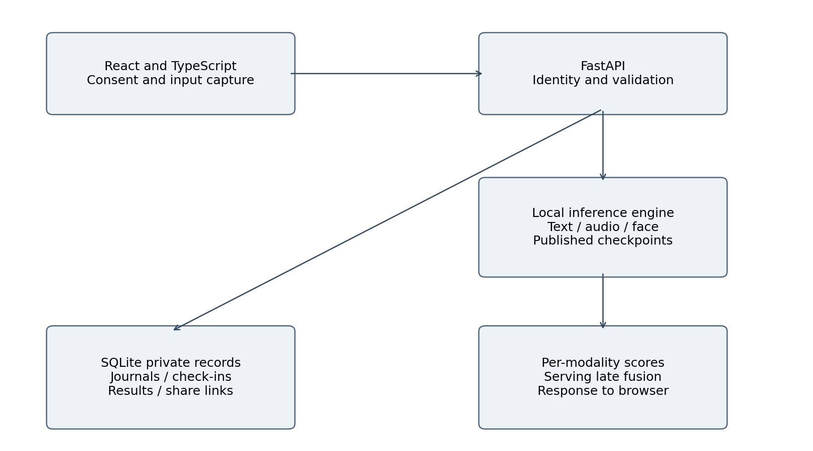
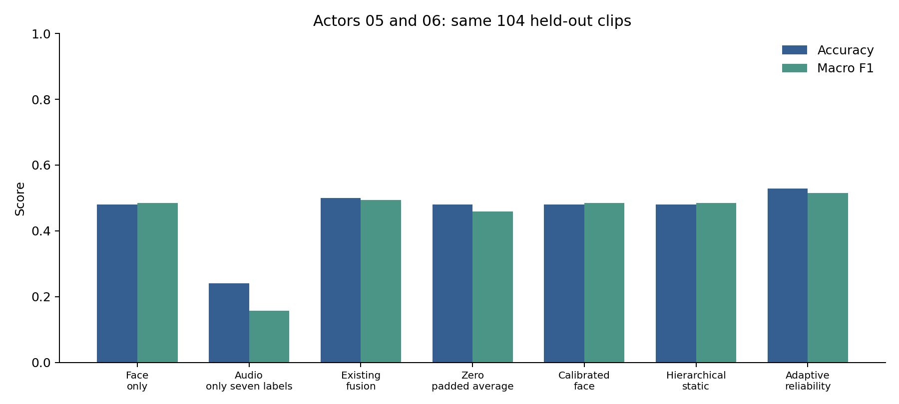
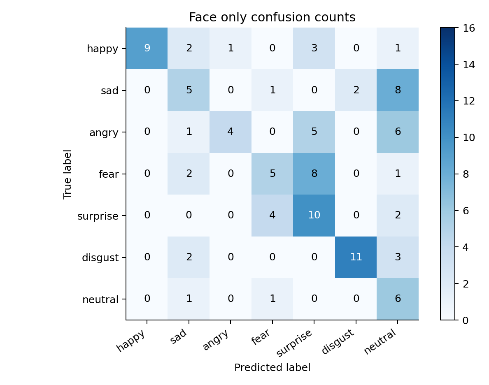
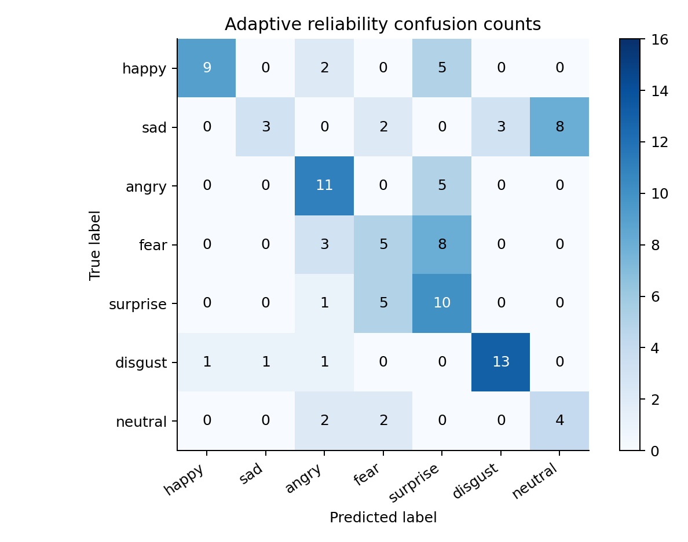

# MindSense

Multimodal Emotion Detection and Mental Health Monitoring

Final year Bachelor of Technology project report

Mohammad Tabrez Alam

Artificial Intelligence and Data Science

Galgotias College of Engineering and Technology

Graduating batch 2027

17 November 2026

<!-- PAGEBREAK -->

## Abstract

MindSense is a research demonstration that combines published text, speech and facial-expression classifiers through late fusion. This report examines the implemented system, its evaluation evidence and a specific failure of audiovisual fusion. It evaluates the strength of the available evidence without treating expression labels as clinical assessments.

Arithmetic verification of the committed prediction records confirms 43.72% accuracy and 0.270 macro F1 for text on 2,610 MELD test utterances. The majority-neutral baseline reaches 48.12% accuracy. On 52 eligible audiovisual clips from RAVDESS Actor 01, face-only classification reaches 40.38% accuracy and 0.392 macro F1; the existing fusion reaches 38.46% and 0.355. Fusion changes four face-only decisions, correcting one error and introducing two. Speech is evaluated separately on its 28 supported-class clips and cannot be compared directly with the seven-class results.

Analysis of the serving code identifies a label-support mismatch: audio produces four classes, while face produces seven. Averaging over a different number of modalities for different classes changes the allocation of normalized scores. This is a testable engineering concern, but the available labels alone do not establish it as the cause of the observed accuracy loss.

The restored actor-disjoint procedure was rerun on 260 real clips with separate fitting, validation and test actors. On the 104 test clips, adaptive class-reliability fusion achieved 52.88% accuracy and 0.5148 macro F1, compared with 50.00% and 0.4933 for existing fusion and 48.08% and 0.4848 for face-only. The selected entropy contribution was zero; actor-level results and calibration measures were mixed, and the two-actor interval crossed zero. This is a limited empirical finding, not a novel algorithm or broad superiority claim.

## Evidence status

| Evidence | Status in this report |
| --- | --- |
| Serving implementation | Serving base a2d7b8e; original protocol 03fc2fd; restored procedure ceb03a1 |
| MELD and Actor 01 metrics | Recomputed from committed prediction labels; no new model inference |
| Actor 02 to 06 follow-up | Exact procedure restored from execution transcript; fresh inference and metrics retained |
| Browser and regression checks | CI logs and screenshot artifact recovered for the inspected commit |

The report addresses three questions: what the application implements, what can explain the fusion failure, and what evidence would be sufficient to support an improvement. The original exploratory evidence, reproduced actor-separated study, and remaining limitations are presented separately.

<!-- PAGEBREAK -->

## Contents

Abstract and evidence status

Introduction and research objectives

1 Related work and project contribution

2 Implemented system

System architecture and implementation details

3 Fusion mathematics and failure hypothesis

4 Verified evaluation method and results

5 Error analysis on Actor 01

6 Actor separated experiment

7 Browser evidence and software verification

8 Security privacy and ethical considerations

9 Discussion limitations and conclusion

References

Appendix A Reproduction and provenance

Appendix B Algorithm and evidence map

<!-- PAGEBREAK -->

## Introduction and research objectives

A person can describe a situation in words, speak with a particular tone, and show a facial expression. These channels are related but can disagree. MindSense makes classifier outputs visible while providing private tools for authored reflection. Its purpose is educational exploration, not the inference of a hidden psychological truth. In the project title, mental health monitoring refers to journals and self-reported check-ins over time; it does not imply that an emotion score diagnoses depression, anxiety, or another condition.

The engineering problem is to connect real models to a reliable application. A prediction demonstration is incomplete if missing checkpoints silently produce guesses, a journal belongs to the wrong user, or a result link exposes unrelated private records. The project therefore treats model provenance, input limits, authentication, ownership, persistence, consent, error recovery, and reproducible setup as core requirements.

The research problem arose from an actual negative result: the original audio/face fusion classified one fewer Actor 01 clip correctly than face-only inference. That observation motivates a controlled comparison rather than a presumption that fusion must help. The speech model recognizes four categories, while the facial model recognizes seven; their scores were trained in different domains and do not automatically represent compatible probabilities.

The first objective is to identify the mathematical effect of the existing averaging rule. The second is to compare support-preserving fusion against face-only, audio-only, existing fusion, an ordinary average, and calibration controls using the same samples. The third is to test whether empirical reliability adds value beyond a constant weight and whether an entropy factor is selected. The fourth is to measure uncertainty and bounded robustness without overstating their meaning.

The hypothesis can fail. A classifier can be confidently wrong, and reliability learned from a few actors can transfer poorly. A scientifically useful result may be a negative finding or a tie with a simpler method. Success in this project means reproducible evidence and accurate interpretation, not a mandatory positive improvement.

### Scope and acceptance criteria

The application supports text, audio and face inference, registration and login, journals, check-ins, history, dashboards, sharing, export and deletion. The new research study is audiovisual. RAVDESS contains repeated semantically neutral statements, so its semantic text is unsuitable for a claim about seven-class text-emotion performance. Three-way integration has been tested, but aligned three-way predictive improvement has not been benchmarked.

| Requirement | Verification approach |
| --- | --- |
| Trained-model provenance | Pinned repositories and revisions in the inference registry |
| No fabricated predictions | Missing-model failure tests and real inference collection |
| Private ownership | Cross-account API regression tests |
| Controlled comparison | Identical held-out score records for all seven methods |
| Separation of data roles | Fixed fitting, validation and test actor identifiers |
| Honest reporting | Negative actor-level and calibration findings retained |

The deliverables are working application code, a bounded experimental contribution, score records and hashes, reproducible scripts, and this academic report. They do not include a deployment, clinical validation, or an asserted new state-of-the-art algorithm.

<!-- PAGEBREAK -->

## 1 Related work and project contribution

Multimodal emotion recognition combines evidence from channels such as speech and facial expression. RAVDESS provides controlled acted audiovisual material [1]; MELD provides conversational text, audio and video [2]. They differ in collection setting and task structure, so results on one should not be interpreted as performance on the other. MindSense uses only MELD text in its verified MELD experiment.

Temperature scaling is an established post-processing approach to confidence calibration [3]. COLD Fusion learns modality-specific latent distributions and constrains their uncertainty through calibration and ordinal ranking [4]. Its audiovisual uncertainty modelling is materially different from a score-level adapter around frozen classifiers. The proposed MindSense investigation neither implements nor directly compares against COLD Fusion. Referencing that work establishes prior art, not an empirical baseline.

The concrete project contribution is integration of pinned published models, explicit label mapping, a transparent serving rule and traceable evaluation. The evaluated fusion adapter is a bounded engineering contribution. A better result on two actors does not by itself establish a new algorithm or a general advantage over established methods.

### Foundations and comparison with existing approaches

Baltrusaitis, Ahuja and Morency organize multimodal learning around representation, translation, alignment, fusion and co-learning [8]. This distinction prevents a score-combination application from being described as a jointly learned representation model. MindSense's current inference path is late fusion. The presence of older cross-attention modules in the repository does not change what the serving API executes.

Baevski and colleagues introduce wav2vec 2.0, which learns speech representations through masking in latent space and a contrastive objective [9]. The published speech expert is an emotion-classification adaptation of that foundation. Speech-recognition results in the foundational paper are not emotion-recognition measurements for this project, and source-dataset accuracy cannot establish RAVDESS performance.

Dosovitskiy and colleagues show how a transformer can process image patches for classification [10]. The facial expert uses a ViT checkpoint specialized for expressions. A cropped frame from acted video differs from its fine-tuning images; the full input path includes a detector and cropper that the encoder paper does not evaluate. This motivates measurement of the actual application path rather than quoting a model-family benchmark.

GoEmotions supplies fine-grained English Reddit emotion labels [11]. Mapping those labels into seven application categories changes the output task. Group maxima avoid simply rewarding categories with more member labels, but they are not a learned alignment or calibration method. The MELD transfer test measures this concrete adapter on independent utterances, without the conversational history available in the original dataset setting.

Simple fixed-weight averaging is an essential control because it isolates whether merely adding another expert changes decisions. Temperature scaling addresses score sharpness but does not repair a missing class. The support-preserving hierarchy addresses group mass, while empirical reliability changes weights by predicted class. These components should be tested separately before crediting a gain to adaptivity. COLD Fusion [4] is a substantially different latent-distribution method; it is prior art, not an executed baseline in this report.

| Method family | What it models | Evaluation status here |
| --- | --- | --- |
| Face and audio separately | Individual frozen expert outputs | Executed controls |
| Equal score averaging | Fixed combination of final scores | Executed controls |
| Temperature scaling | Confidence sharpness | Fitted control |
| Hierarchical fusion | Shared and unsupported label mass | Executed adaptation |
| Class reliability and entropy | Predicted class precision and score concentration | Validation-selected variant |
| COLD Fusion | Calibrated ordinal latent distributions | Literature comparison only |

### Research gap and falsifiable contribution

The defensible gap is project-specific: the serving application had no actor-separated evidence showing whether its mismatched label spaces and uncalibrated expert scores helped or harmed classification. Reliability-aware fusion already exists in published research. This study tests a lightweight adapter around the actual frozen experts, includes simpler controls, and preserves unsuccessful findings. It does not establish that this combination has never appeared elsewhere.

The primary comparison is adaptive fusion against the current serving rule on identical test clips. Face-only, calibration and static weighting reveal whether any advantage requires an adaptive rule. Per-actor analysis tests whether an aggregate gain is consistent; score-based stress checks test bounded failure scenarios. These comparisons can reject a broad improvement claim even when the overall accuracy rises.

<!-- PAGEBREAK -->

## 2 Implemented system

The React frontend sends requests to a FastAPI backend. The inference service loads local model files, preprocesses the supplied modalities, obtains classifier scores and combines them. A model lock serializes inference within the supported single process. The active API does not instantiate the older cross-attention research network [R1, R2].

| Input | Published model | Serving interpretation |
| --- | --- | --- |
| English text | SamLowe/roberta-base-go_emotions | Sigmoid outputs grouped into seven labels using group maxima, then normalized |
| Speech at 16 kHz | superb/wav2vec2-base-superb-er | Softmax scores for happy, sad, angry and neutral |
| One facial image | trpakov/vit-face-expression | Softmax scores for seven expression classes after face detection and cropping |

The model cards describe GoEmotions, IEMOCAP/SUPERB and FER2013 as the respective task data [5-7]. Their published metrics are not substituted for MindSense measurements. The serving registry pins exact revisions, reproduced in Appendix A.

Text is limited to the first 256 tokens. Audio is decoded to 16 kHz and accepted between 0.1 and 30 seconds. Facial analysis requires exactly one detectable frontal face. These constraints affect coverage and should be reported alongside accuracy.

Guest results are returned without saving them. Authenticated history stores result metadata and scores; the architecture documents separate private journaling, check-ins, export and deletion. The application does not persist raw analysis text, photographs or recordings. This does not mean that journal entries are never stored. SQLite lacks application-level encryption, and browser bearer tokens use localStorage [R2].

<!-- PAGEBREAK -->

## System architecture and implementation details

### Runtime architecture

The React and TypeScript frontend calls same-origin /api routes. Vite proxies these calls during development; FastAPI serves both the built frontend and the API in the container. The backend validates identity and input, offloads CPU inference to a worker thread, and applies a process-local lock around model use. The documented deployment uses one process; it is not a horizontally scaled serving cluster.

Figure 1. Runtime components derived from the serving code. The experiment does not replace the application fusion rule.

Models are downloaded explicitly during setup. Inference uses local files and disables remote model code. The registry pins the revision, expected weight filename, label aliases and text grouping. The model-status endpoint distinguishes installed files from successfully loaded models. A health endpoint only establishes process availability; successful inference must be verified separately.

### Active database design

The active persistence layer is SQLite accessed by database.py using parameterized queries. The repository also includes SQLAlchemy model declarations, but these are not the schema authority used by the current serving routes. Schema initialization adds required columns to existing local databases, including result_json and authentication-version fields.

Figure 2. Core owner and result relationships in the active SQLite implementation. Ancillary developer and feedback tables are omitted from this focused diagram.

| Table | Stored purpose | Ownership relationship |
| --- | --- | --- |
| users | Identity profile salted password hash auth version | Account identity |
| analyses | Summary and full result JSON | user_id |
| modality_results | Individual expert summaries | analysis_id |
| daily_notes | Journal title content and mood tag | user_id |
| daily_checkins | User-reported scores and optional notes | user_id |
| share_links | Token result expiry revocation | owner_id and result_id |
| login_sessions | Login history | user_id |

Guest analysis returns a result without inserting it. Authenticated results retain model evidence and ownership. Raw analysis text, photographs and audio are not persisted by this path; journal entries and check-in notes are distinct features that users deliberately save. Account deletion explicitly removes relevant records and sharing access rather than relying only on nullable foreign-key behavior.

### Frontend and API integration

The analysis screen shows checkpoint availability, consent, loading states, errors, per-modality scores and disagreement warnings. The user may provide a subset of modalities. Audio recording and camera capture release their media streams after use. File size, image resolution, text length and duration limits are explained at input. The frontend restores sessions and hash routes after refresh; private routes require authentication.

The journal saves authored reflections, retrieves them after reload, and supports deletion. Check-ins preserve self-reported values rather than manufacturing a mental-health score. Dashboard summaries use stored records. The assistant is a scripted guide and the game is educational; neither supplies research labels or a clinical assessment.

FastAPI uses a consistent success/error envelope. Inference is multipart, while account and journal routes accept structured bodies. Identity comes from a validated bearer token rather than an arbitrary user identifier supplied in the request. The backend checks ownership when reading, deleting, exporting or sharing private data.

### Authentication and sharing

Passwords use salted PBKDF2-SHA256. Signed tokens require the expected algorithm, expiry, account type and current authentication version. Logout revokes the session token; password changes and resets invalidate prior versions. Password reset tokens are hashed, expire after 30 minutes and are single use. Production recovery requires configured SMTP and does not disclose the reset token in the API response.

Only an authenticated result owner can create or revoke a result link. Links are random bearer tokens with expiry. A valid link exposes the selected result, not journals or raw input. Anyone who obtains it can use it while active. History clearing and account deletion remove associated access. This is controlled sharing, not a promise that a bearer URL remains private after it is forwarded.

### Deployment preparation

The repository contains a Dockerfile, compose configuration, environment example, administrator creation script and Windows setup instructions. Model files and SQLite data need persistent storage. Production requires an explicit signing secret. Local development generates a private key file. No default production accounts are created.

Container startup has been checked in CI. Production load, TLS termination, encrypted volumes, backup restoration, retention and live email still require deployment-specific verification. A successful health check is not evidence of capacity or clinical-data compliance. No merge or deployment was performed as part of this report.

<!-- PAGEBREAK -->

## 3 Fusion mathematics and failure hypothesis

Let L contain happy, sad, angry, fear, surprise, disgust and neutral. Let S be the audio-supported subset containing happy, sad, angry and neutral, and let U = L minus S. Write a(k) for normalized audio scores on S and b(k) for normalized face scores on L.

The serving rule averages each label only across modalities that expose that label and then normalizes the resulting vector [R1]. With audio and face present, the pre-normalization score is:

    r(k) = (a(k) + b(k)) / 2     for k in S
    r(k) = b(k)                  for k in U

Define u = sum of b(k) over U. Since audio sums to one over S and face sums to one over L, the normalization constant and final score are:

    Z = 1 + u / 2
    p(k) = r(k) / Z
    sum over U of p(k) = u / (1 + u / 2)

For 0 < u <= 1, the final unsupported-class mass is lower than the face-only mass u. Normalizing the vector does not preserve the original allocation across the supported and unsupported groups. This is a structural property of the code, independent of dataset performance. It also differs from zero-padding audio to seven labels and taking an ordinary equal-weight mixture, which would assign total unsupported mass u/2.

As a constructed arithmetic illustration, take face scores happy = 0.55 and fear = 0.45, and audio happy = 1. The legacy rule assigns fear 0.45/1.225, approximately 0.3673. This illustration is not a model prediction or performance measurement.

### A comparator that preserves mass

A candidate comparator can preserve the face model's total mass on unsupported classes while allowing audio to redistribute only the supported mass. For a fixed weight w between zero and one:

    q(k) = b(k)                                  for k in U
    q(k) = (1-w)b(k) + w(1-u)a(k)                 for k in S

The scores remain non-negative and sum to one. At w = 0 this is face-only classification. At w = 1, audio distributes the supported mass 1-u. The formula remains defined when u = 1. The restored experiment implements this hierarchy on temperature-scaled probabilities. Its results and controls are reported below; mathematical coherence alone does not establish improved performance.

The assumption is consequential: the face model is trusted to allocate mass between S and U. If that allocation is wrong, preservation can retain the error. Temperature scaling and reliability weighting introduce additional choices that require development data. A mechanism that is mathematically coherent is not automatically empirically better.

<!-- PAGEBREAK -->

## 4 Verified evaluation method and results

The committed evaluator uses the complete 2,610-row official MELD test CSV. It maps joy to happy, sadness to sad and anger to angry, then evaluates each utterance independently without dialogue context. This measures transfer through the seven-label adapter, not a model trained on MELD [R3, R4].

For RAVDESS Actor 01, the evaluator selects full audiovisual speech files, excludes calm, reads a fixed midpoint frame and runs audio and face inference on the same clip. The report records 52 eligible clips and no decoding or face-detection failures. Speech metrics retain only 28 clips whose true label belongs to S. No new model fitting is performed by this evaluator [R3, R5].

| Dataset and method | Clips or utterances | Classes | Accuracy | Macro F1 |
| --- | --- | --- | --- | --- |
| MELD text adapter | 2,610 | 7 | 43.72% | 0.270 |
| MELD majority neutral | 2,610 | 7 | 48.12% | Not reported here |
| Actor 01 speech | 28 | 4 | 46.43% | 0.366 |
| Actor 01 face | 52 | 7 | 40.38% | 0.392 |
| Actor 01 existing fusion | 52 | 7 | 38.46% | 0.355 |

Accuracy is the fraction of correct labels. Macro F1 is the unweighted mean of per-class F1 over the fixed class set. The verification script reconstructs confusion matrices and class precision, recall, F1 and support from individual prediction records. It checks these against every saved metric. This verifies internal numerical consistency; it does not independently regenerate classifier outputs from media.

Text is 4.41 percentage points below the majority-neutral baseline. Its macro F1 and per-class errors remain relevant, but they do not erase the accuracy deficit. Face predicts 21 of 52 Actor 01 clips correctly; fusion predicts 20. Speech's 13 correct predictions out of 28 use a different sample set and label space, so its 46.43% accuracy is not evidence that it outperforms face.

Figure 3. Recomputed confusion matrices for the same 52 Actor 01 clips. Rows are true labels and columns are predicted labels. These counts reproduce the committed reports; they are not new inference.

<!-- PAGEBREAK -->

## 5 Error analysis on Actor 01

Fusion and face agree on 48 of 52 predicted labels. They are both correct on 19 clips and both wrong on 30. Two clips move from a correct face prediction to an incorrect fusion prediction; one moves in the opposite direction. The fourth changed decision remains incorrect.

| RAVDESS filename | True | Face | Fusion | Change |
| --- | --- | --- | --- | --- |
| 01-01-04-02-01-02-01.mp4 | sad | sad | neutral | Introduces error |
| 01-01-05-01-01-02-01.mp4 | angry | neutral | angry | Corrects error |
| 01-01-06-02-02-02-01.mp4 | fear | disgust | angry | Both wrong |
| 01-01-07-01-02-01-01.mp4 | disgust | disgust | neutral | Introduces error |

The net change is one fewer correct prediction, or -1.92 percentage points. This small count is more informative than describing fusion as a general failure. The two introduced errors involve different support situations: sad is supported by audio, while disgust is not. Label-support imbalance therefore cannot be asserted as the sole cause from these records.

| Class | Support | Face F1 | Existing fusion F1 |
| --- | --- | --- | --- |
| happy | 8 | 0.857 | 0.857 |
| sad | 8 | 0.222 | 0.000 |
| angry | 8 | 0.667 | 0.706 |
| fear | 8 | 0.000 | 0.000 |
| surprise | 8 | 0.222 | 0.222 |
| disgust | 8 | 0.533 | 0.462 |
| neutral | 4 | 0.242 | 0.235 |

The existing reports preserve top labels and file hashes, but not the full per-modality score vectors for every clip. Consequently, they support paired correctness analysis and confusion matrices. They do not support reconstructing alternative fusion probabilities, temperature scaling, expected calibration error or negative log-likelihood. Those analyses require retained logits or score vectors and an explicit metric definition.

Actor 01 is a diagnostic case that motivated the hypothesis. It cannot serve as a fresh test of a method designed after examining its errors. Its exclusion from the subsequent actor-separated protocol is appropriate. The same caution now applies to any new design decision made after reading the previously observed Actor 05 and 06 outcomes.

<!-- PAGEBREAK -->

## 6 Actor separated experiment

### Dataset roles and preprocessing

The fixed protocol assigns Actors 02 and 03 to fitting, Actor 04 to validation, and Actors 05 and 06 to testing. Actor 01 is excluded because its errors motivated the method. The allocation is a project subset, not an official RAVDESS split. Each actor contributes 52 non-calm audiovisual speech clips. Only filenames starting 01-01 are retained from official Video_Speech_Actor archives. Calm is excluded, not relabeled as neutral. Each actor contributes four neutral clips and eight clips for each other retained class. Thus the test set contains eight neutral clips and sixteen for each of the other six classes. The two repeated statements and intensity/repetition structure create within-actor dependence; 104 clips are not 104 independent people.

The collector takes the midpoint video frame, converts BGR to RGB, and invokes the production one-face cropper and published model. The same clip supplies mono 16 kHz audio. Audio must be finite, audible and between 0.1 and 30 seconds. No frame is selected using its emotion label; no favorable examples replace failed inputs. Every record includes actor, truth, filename, SHA-256 and either actual model outputs or a failure. The full paired comparison retains the same successfully processed samples for every method.

Figure 4. Actor boundaries separate fitting, selection and final evaluation.

### Frozen models and architecture

The experts are published checkpoints, not networks trained from scratch here. The audio configuration is Wav2Vec2ForSequenceClassification with 12 transformer layers, 768 hidden dimensions, 12 attention heads and a 256-dimensional classifier projection. The image configuration is ViTForImageClassification with 12 layers, 768 hidden dimensions, 12 heads, 224-pixel input and 16-pixel patches. These values come from the downloaded checkpoint configuration files. The text expert is a RoBERTa multi-label classifier; it is not part of this audiovisual experiment.

Audio and image use softmax over their respective logits. Label aliases are explicitly mapped by name. Text uses sigmoid over its original fine-grained labels, then group maxima and normalization. The canonical seven-label order is happy, sad, angry, fear, surprise, disgust, neutral. The audio order used in the experiment is happy, sad, angry, neutral.

The neural weights remain frozen. Fitting learns only post-processing temperatures and class reliability. The code from the original execution record was restored and committed as ceb03a1 before rescoring. No test-guided parameter or grid change was made. The rerun reproduces a previously observed evaluation, not new independent validation.

### Temperature and empirical reliability

For each model, temperature scaling computes p_c(T) proportional to max(p_c, 10^-12) raised to 1/T. Candidates are 0.5, 1, 2 and 4. Training negative log likelihood selects the minimum; audio fitting includes only training truth labels it supports, while face fitting includes all training labels. A positive temperature preserves the ordering of an individual expert but can change a fused decision.

Predicted-class reliability is r_c = (1 + correct predictions of c) / (2 + total predictions of c), a Beta(1,1)-smoothed precision estimate. An unseen predicted class receives 0.5, not certainty. Audio reliability is fitted conditional on supported truth labels. That condition can overestimate its usefulness on the full seven-class problem and is an explicit limitation.

### Hierarchical and adaptive fusion

Let m be calibrated facial probability mass on the four audio-supported labels S. The hierarchy retains face probabilities outside S and returns m[(1-w) times normalized face scores on S + w times audio scores] within S. It preserves total group mass while allowing audio to change the relative supported-class allocation. Its constant weight is selected from 0, 0.25, 0.5, 0.75 and 1 using validation macro F1.

For adaptive weighting, entropy is H(p) = -sum p_c log p_c. Define Q = r_argmax(p) times max(1-H(p)/log(K), 10^-6)^gamma. The per-sample audio weight is alpha Q_audio / [alpha Q_audio + (1-alpha)Q_face], with a numerical denominator floor. The validation search uses the same five alpha values and gamma in 0, 1 and 2. First-grid-value tie breaking is deterministic. Gamma zero removes entropy; alpha zero returns calibrated face-only inference.

The controls are face-only, audio-only zero-padded to seven categories, existing support-aware averaging, ordinary zero-padded averaging, calibrated face, hierarchical constant weighting, and adaptive reliability. Audio-only is evaluated on all seven truth categories to keep the denominator identical; its unsupported classes remain visible as errors.

### Metrics robustness and uncertainty

Accuracy is exact top-label correctness. Macro F1 averages all seven per-class F1 values with zero for undefined classes. Confusion matrices use true labels as rows and predicted labels as columns. NLL averages -log p_true with a 10^-12 floor. The multiclass Brier score sums squared errors over classes before averaging examples; it is not divided by seven.

ECE uses ten equal-width bins of maximum confidence and sums bin frequency times the absolute difference between accuracy and confidence. Selective accuracy ranks by maximum score and retains approximately 50%, 80% or 100% of cases. Neither metric establishes a clinical abstention threshold. Entropy describes predictive score concentration, not all forms of uncertainty.

Missing audio falls back to calibrated face; missing face falls back to raw audio padded to seven classes. The deterministic contamination condition replaces calibrated audio scores with 0.5a + 0.5/4. This is a score-level stress test, not an experiment with noisy microphones, compression or occluded faces. The selected parameters are not retuned after contamination.

A paired actor bootstrap samples the two test actors with replacement for 1000 replicates, seed 20261116, retaining each actor's clips together. It reports adaptive-minus-face macro F1. With only two clusters, its interval is unstable and descriptive; it does not establish population significance.

### Completed sample counts and selected parameters

| Role | Actors | Complete samples |
| --- | --- | --- |
| Fitting | 02 and 03 | 104 |
| Validation | 04 | 52 |
| Test | 05 and 06 | 104 |

Recorded input failures: 0. No random predictions, replacement weights or fabricated labels were used.

| Parameter | Selected value |
| --- | --- |
| audio_temperature | 4 |
| face_temperature | 2 |
| static_audio_weight | 0 |
| adaptive_prior | 0.75 |
| entropy_power | 0 |

### Baseline comparison on identical held out samples

| Method | Validation F1 | Test accuracy | Test macro F1 |
| --- | --- | --- | --- |
| Face only | 0.5171 | 48.08% | 0.4848 |
| Audio only seven labels | 0.1228 | 24.04% | 0.1572 |
| Existing fusion | 0.5013 | 50.00% | 0.4933 |
| Zero padded average | 0.4114 | 48.08% | 0.4585 |
| Calibrated face | 0.5171 | 48.08% | 0.4848 |
| Hierarchical static | 0.5171 | 48.08% | 0.4848 |
| Adaptive reliability | 0.5647 | 52.88% | 0.5148 |

Figure 5. Same-sample accuracy and macro F1 for the seven methods.

Adaptive reliability classified 55 of 104 clips correctly; existing fusion classified 52, and face-only classified 50. The adaptive change over existing fusion is 2.88 percentage points in accuracy and 0.0216 in macro F1. These are sample-specific differences, not a general superiority claim.

Validation selected zero audio weight for the static hierarchy, so that method equals calibrated face. The adaptive entropy exponent is zero: the selected variant uses class-conditioned reliability, and the result does not establish a benefit from the entropy term.

Existing fusion damaged 5 correct facial decisions and repaired 7 wrong ones on these test actors. Its disagreement rate with face-only was 23.08%. The earlier Actor 01 accuracy loss therefore does not recur as a universal ordering. The support-normalization mechanism is real, but it is not proved to be the cause of every error.

Figure 6. Face-only confusion counts for Actors 05 and 06.

Figure 7. Existing fusion on the same held-out records.

Figure 8. Adaptive reliability on the same held-out records.

### Actor variation and score uncertainty

| Actor | Face F1 | Existing F1 | Adaptive F1 |
| --- | --- | --- | --- |
| 5 | 0.3421 | 0.3751 | 0.4225 |
| 6 | 0.5500 | 0.5233 | 0.5088 |

Adaptive macro F1 improves on Actor 05 but decreases on Actor 06 relative to both face-only and existing fusion. Aggregate improvement hides heterogeneous class behavior.

The descriptive actor-bootstrap 95% interval for adaptive-minus-face macro F1 is [-0.0412, 0.0804]. It crosses zero. Only two test actors make this too fragile for a population confidence or significance claim.

| Method | NLL | Brier | ECE |
| --- | --- | --- | --- |
| Face only | 2.0496 | 0.8087 | 0.3293 |
| Audio only seven labels | 13.7660 | 1.2259 | 0.5414 |
| Existing fusion | 1.7142 | 0.6816 | 0.0718 |
| Zero padded average | 1.8293 | 0.7297 | 0.1036 |
| Calibrated face | 1.4936 | 0.6860 | 0.1421 |
| Hierarchical static | 1.4936 | 0.6860 | 0.1421 |
| Adaptive reliability | 1.3429 | 0.6324 | 0.1243 |

The adaptive method lowers NLL and Brier loss relative to existing fusion but has higher ECE. Uncertainty quality therefore does not improve under every measure. Calibration changes no face-only top labels, as expected.

Figure 9. Actor variation and confidence-ranked selective accuracy.

<!-- PAGEBREAK -->

### Prespecified stress conditions

| Condition | Accuracy | Macro F1 |
| --- | --- | --- |
| missing audio | 48.08% | 0.4848 |
| missing face | 24.04% | 0.1572 |
| uniform audio contamination adaptive | 54.81% | 0.5421 |
| uniform audio contamination static | 48.08% | 0.4848 |

Flatter audio scores improve the selected adaptive result here. That is a post-evaluation observation, not permission to tune the method on test data. Since entropy power is zero, this improvement does not demonstrate entropy-aware corruption rejection. Missing-face performance remains poor because audio cannot predict three target labels.

### Research finding and serving decision

The bounded contribution is a reproducible comparison and support-preserving class-reliability adaptation around heterogeneous frozen experts. It is not invention of uncertainty-aware fusion, reproduction of COLD Fusion, or evidence of clinical utility. The existing application fusion remains unchanged while the experimental module and its limitations are made available for review.

<!-- PAGEBREAK -->

## 7 Browser evidence and software verification

Figure 10. Genuine Chromium screenshot from the PR workflow at commit 03fc2fd. The browser artifact also contains mobile-analysis.png and real-text-result.png. Originals are preserved without alteration alongside the report source.

| Check at inspected commit | Verified result |
| --- | --- |
| Backend pytest | 143 passed and 5 skipped |
| Frontend Vitest | 10 passed |
| Browser Playwright | 6 passed |
| Production build and audit workflow | Completed successfully |

The result screenshot shows authored guest text classified as happy with a 97.9% uncalibrated score. It explicitly shows audio and image models as not installed in that browser environment. It proves the text-only UI path ran, not successful browser inference across all three modalities. The restored code passed 149 backend/research tests with five legacy skips in CI at ff1fba7. This includes the 143 existing backend tests and six research checks; the frontend suite passed 10 tests and the production build, and all six Playwright browser tests passed. The research checks also passed locally on 17 November. They cover mass conservation, limiting weights, temperature ordering, reliability smoothing, exact serving-baseline equivalence, metrics and actor separation. These deterministic fixtures are not performance samples. The original screenshot provenance remains tied to [R7]; the restored-code verification is linked in [R8].

Figure 11. Actual guest text inference from the preserved CI screenshot; cropped for readability, with original pixels and source image retained.

<!-- PAGEBREAK -->

## 8 Security privacy and ethical considerations

Emotion inputs and journals are sensitive even in an educational prototype. The application minimizes stored analysis inputs, makes results private by default, and requires ownership checks for private records. Export and deletion let users inspect and remove their records. No sensitive journal content is required for the benchmark; the research cache contains public dataset identifiers and classifier outputs.

SQLite lacks application-level encryption. Sessions stored in browser localStorage remain exposed to cross-site scripting. Rate limits are process-local. A real host must secure TLS, secrets, volumes, backups and logs. Application deletion does not prove that external backup copies have been erased; deployment retention policies must handle this separately. Passing automated tests or vulnerability scans does not constitute a complete security audit.

RAVDESS labels describe acted expressions. They do not measure diagnosis, intention, truthfulness, workplace suitability or treatment benefit. Predictions should not support consequential decisions about a person. The application does not infer sensitive demographic attributes or claim fairness across demographic groups. Its data and checkpoints do not establish generalization across cultures, accents, languages, disability, lighting or spontaneous behavior.

Model and dataset licenses are separate obligations. Source model-card scores are not project measurements. Raw RAVDESS media are downloaded from the official record and not committed. The data record specifies CC BY-NC-SA 4.0; the article publication license must not be confused with the media license. Human-subject recruitment is inactive unless a legitimate study is separately approved and configured.

<!-- PAGEBREAK -->

## 9 Discussion limitations and conclusion

The reproduced study supports a modest aggregate improvement for calibrated, support-preserving class-reliability fusion on this small subset. It also supplies reasons for restraint: the static method rejected audio, entropy was not selected, one actor lost macro F1, and ECE worsened relative to existing fusion. Those findings remain part of the contribution. The serving default is retained; a larger evaluation is needed before recommending a general replacement.

The experiment fits on two actors, validates on one and tests on two. It is not full 24-actor evaluation or repeated actor-disjoint cross-validation. The validation actor may favor a setting that transfers poorly, and two bootstrap clusters do not support population inference. A single midpoint frame loses motion and can show a transitional expression. The speech expert lacks fear, surprise and disgust outputs, and preserving visual group mass can preserve a visual mistake.

The text adapter remains below a majority-neutral accuracy baseline on MELD. No aligned three-way predictive benchmark or clinical validation was completed. Original cross-attention research assets remain missing. Published checkpoints also prevent a comprehensive audit of all upstream pretraining overlap; project-level actor separation does not prove universal upstream data independence.

The restoration rerun reproduces an already observed experiment; it is not new independent evidence. The exact computational procedure was restored from the earlier execution transcript and committed before rescoring. No objective or grid was changed using known test outcomes. The original score bytes were lost, so provenance records distinguish regenerated artifacts from byte-for-byte recovery.

### Future scope

A larger study should preregister nested actor-disjoint folds, with all calibration and selection performed inside each training partition. Additional untouched actors are needed before a changed method can claim fresh generalization. A seven-class audio model could remove the current support mismatch, but would require licensed data and a new comparison. Temporal facial aggregation could test the midpoint limitation.

An aligned conversational dataset could support text/audio/face evaluation if speaker partitions, context and label definitions are valid. Reproducing COLD Fusion would require its training design and a shared evaluation setup before any numerical comparison. Live microphone/camera testing, SMTP delivery, load capacity, encrypted storage and backup restoration remain deployment work. None of these extensions should silently change the meaning of the current evidence.

<!-- PAGEBREAK -->

## References

[1] Livingstone, S. R., and Russo, F. A. (2018). The Ryerson Audio-Visual Database of Emotional Speech and Song (RAVDESS): A dynamic, multimodal set of facial and vocal expressions in North American English. PLOS ONE, 13(5), e0196391. [DOI 10.1371/journal.pone.0196391](https://doi.org/10.1371/journal.pone.0196391).

[2] Poria, S., Hazarika, D., Majumder, N., Naik, G., Cambria, E., and Mihalcea, R. (2019). MELD: A Multimodal Multi-Party Dataset for Emotion Recognition in Conversations. Proceedings of ACL, 527-536. [ACL Anthology](https://aclanthology.org/P19-1050/).

[3] Guo, C., Pleiss, G., Sun, Y., and Weinberger, K. Q. (2017). On Calibration of Modern Neural Networks. Proceedings of ICML, PMLR 70, 1321-1330. [PMLR](https://proceedings.mlr.press/v70/guo17a.html).

[4] Tellamekala, M. K., Amiriparian, S., Schuller, B. W., Andre, E., Giesbrecht, T., and Valstar, M. (2023). COLD Fusion: Calibrated and Ordinal Latent Distribution Fusion for Uncertainty-Aware Multimodal Emotion Recognition. Version 2, accepted to IEEE TPAMI. [arXiv 2206.05833v2](https://arxiv.org/abs/2206.05833v2).

[5] SamLowe. roberta-base-go_emotions model card. [Model documentation](https://huggingface.co/SamLowe/roberta-base-go_emotions).

[6] SUPERB. wav2vec2-base-superb-er model card. [Model documentation](https://huggingface.co/superb/wav2vec2-base-superb-er).

[7] trpakov. vit-face-expression model card. [Model documentation](https://huggingface.co/trpakov/vit-face-expression).

[8] Baltrusaitis, T., Ahuja, C., and Morency, L.-P. (2017). Multimodal Machine Learning: A Survey and Taxonomy. [arXiv 1705.09406](https://arxiv.org/abs/1705.09406).

[9] Baevski, A., Zhou, H., Mohamed, A., and Auli, M. (2020). wav2vec 2.0: A Framework for Self-Supervised Learning of Speech Representations. [arXiv 2006.11477](https://arxiv.org/abs/2006.11477).

[10] Dosovitskiy, A., et al. (2020). An Image is Worth 16x16 Words: Transformers for Image Recognition at Scale. [arXiv 2010.11929](https://arxiv.org/abs/2010.11929).

[11] Demszky, D., Movshovitz-Attias, D., Ko, J., Cowen, A., Nemade, G., and Ravi, S. (2020). GoEmotions: A Dataset of Fine-Grained Emotions. ACL, 4040-4054. [DOI 10.18653/v1/2020.acl-main.372](https://aclanthology.org/2020.acl-main.372/).

The original implementation references R1 to R6 point to commit 03fc2fd978adc071bb8685c1216bd4a03911da0e, inspected on 16 November 2026. Literature and model-card pages were checked on the same date. Model-card metrics are background only.

[R1] MindSense inference [service.py](https://github.com/Mohammadtabrejalam/Emotion-detection-by-using-multi-modal-fusion-mental-health-monitoring./blob/03fc2fd978adc071bb8685c1216bd4a03911da0e/backend/app/inference/service.py) and [registry.py](https://github.com/Mohammadtabrejalam/Emotion-detection-by-using-multi-modal-fusion-mental-health-monitoring./blob/03fc2fd978adc071bb8685c1216bd4a03911da0e/backend/app/inference/registry.py).

[R2] [ARCHITECTURE.md](https://github.com/Mohammadtabrejalam/Emotion-detection-by-using-multi-modal-fusion-mental-health-monitoring./blob/03fc2fd978adc071bb8685c1216bd4a03911da0e/ARCHITECTURE.md).

[R3] [Evaluation method and reproduction instructions](https://github.com/Mohammadtabrejalam/Emotion-detection-by-using-multi-modal-fusion-mental-health-monitoring./blob/03fc2fd978adc071bb8685c1216bd4a03911da0e/docs/EVALUATION_PUBLISHED.md) and [evaluator source](https://github.com/Mohammadtabrejalam/Emotion-detection-by-using-multi-modal-fusion-mental-health-monitoring./blob/03fc2fd978adc071bb8685c1216bd4a03911da0e/scripts/evaluate_published.py).

[R4] [MELD prediction report](https://github.com/Mohammadtabrejalam/Emotion-detection-by-using-multi-modal-fusion-mental-health-monitoring./blob/03fc2fd978adc071bb8685c1216bd4a03911da0e/reports/meld_text.json).

[R5] [Actor 01 prediction report](https://github.com/Mohammadtabrejalam/Emotion-detection-by-using-multi-modal-fusion-mental-health-monitoring./blob/03fc2fd978adc071bb8685c1216bd4a03911da0e/reports/ravdess_actor01.json).

[R6] [Frozen fusion protocol](https://github.com/Mohammadtabrejalam/Emotion-detection-by-using-multi-modal-fusion-mental-health-monitoring./blob/03fc2fd978adc071bb8685c1216bd4a03911da0e/research/fusion_v2/protocol.json).

[R7] [CI run 43871924375](https://github.com/Mohammadtabrejalam/Emotion-detection-by-using-multi-modal-fusion-mental-health-monitoring./actions/runs/43871924375), browser artifact 14227524645, and [companion CI run 43871924186](https://github.com/Mohammadtabrejalam/Emotion-detection-by-using-multi-modal-fusion-mental-health-monitoring./actions/runs/43871924186).

[R8] [Restored-code comprehensive verification](https://github.com/Mohammadtabrejalam/Emotion-detection-by-using-multi-modal-fusion-mental-health-monitoring./actions/runs/44052718924) at ff1fba7, and [container/build workflow](https://github.com/Mohammadtabrejalam/Emotion-detection-by-using-multi-modal-fusion-mental-health-monitoring./actions/runs/44052718377).

[R9] [Preserved real-inference reproduction](https://github.com/Mohammadtabrejalam/Emotion-detection-by-using-multi-modal-fusion-mental-health-monitoring./actions/runs/44052351282), using the restored computational procedure without test-guided changes.

<!-- PAGEBREAK -->

## Appendix A Reproduction and provenance

### Pinned model revisions

| Modality | Exact model revision |
| --- | --- |
| Text | d75048347613a25d77de8cf6412eaae9fa7b26be |
| Audio | 441a7599c3b22107314dcbd9166621c5c83f2cc5 |
| Face | ef0bc6fc34241b6587e7e009e7711357be28c024 |

The committed inference reports record Python 3.12.14, CPU PyTorch 2.15.0, Transformers 5.23.0 and OpenCV 4.11.0.86. The earlier local reproduction records its package versions in research/fusion_v2/environment.json. The preserved GitHub Actions inference run records its installed packages in research/fusion_v2/reproduction_environment.txt [R9]. The published checkpoints were downloaded at the same pinned revisions.

### Numerical verification

From the repository root, run:

    python -m scripts.verify_report_evidence

The standard-library-only verifier writes research/fusion_v2/verified_report_evidence.json. It checks unique prediction identifiers, sample counts, accuracy, macro and weighted F1, per-class statistics and confusion matrices. It also lists the four changed Actor 01 predictions. It does not download datasets, fit models or infer new labels.

Full model evaluation follows [R3]. Dataset media and weights are not distributed with this report. The RAVDESS data record should be consulted for its usage terms; the repository records CC BY-NC-SA 4.0 for the evaluated media. The article's publication license and the dataset license must not be conflated.

### Evidence integrity

The recovered browser ZIP SHA256 matches the artifact digest returned by GitHub:

    7d9e3bce8ffecffba5e4407064b4669d7851a3550836ec792bca2629405e133c

The committed MELD source CSV hash is:

    8d37103938f7067600839fe29d5a114a6cd1bcdafb75bec101e06464c5006888

Exact SHA256 hashes for the saved prediction reports are included in the verifier output. The report source and browser images are preserved with the repository. The follow-up score records, exact experiment source, fitted parameters, metrics, per-actor results and seeded bootstrap generator are now retained under research/fusion_v2. Its RECOVERY.md explains the interrupted artifact history and the rerun boundary.

### Viva questions supported by the evidence

Why can fusion be worse? An inaccurate modality can change a correct decision; in Actor 01 this happened twice, while one error was corrected. Differing label support also changes the score allocation, although its empirical contribution is not isolated.

What is original here? The implemented integration, explicit adapters and project-specific empirical audit are supportable contributions. The report does not claim invention of reliability-aware fusion or temperature scaling.

Did the new method generalize? The reproduced study reports a small aggregate gain on two actors, accompanied by a per-actor decline and an uncertainty interval crossing zero. It supports a bounded finding, not broad superiority.

### Research and report execution

    python -m pip install -r research/fusion_v2/requirements.txt
    python -m pytest research/fusion_v2/test_experiment.py -q
    python -m research.fusion_v2.experiment
    python -m scripts.generate_research_report
    python -m scripts.build_academic_report

Cached-score reproduction requires neither neural weights nor raw media. Full reproduction additionally installs backend/requirements-inference.txt, CPU PyTorch and FFmpeg, downloads the pinned experts, archives the current scores.jsonl, and runs python -m research.fusion_v2.collect. RAVDESS_CACHE selects a writable media directory. The default is ignored data/raw/ravdess-fusion-v2. Several gigabytes of temporary storage can be needed while archives download.

The report generator assembles the template with results.json and creates data-derived figures. The DOCX builder converts that complete Markdown source. PDF conversion requires LibreOffice; render all pages and inspect them after a toolchain change. The code, evidence and report outputs are maintained on the existing draft PR. The research reproduction workflow preserves scores and metrics as downloadable artifacts, so the experiment does not depend on a temporary authoring workspace.

<!-- PAGEBREAK -->

## Appendix B Algorithm and evidence map

    1 Read the frozen actor protocol and the actual score cache.
    2 Require unique clip IDs and all prescribed actor records.
    3 Use the same successful audio and face pairs for every method.
    4 Fit temperatures and class reliability on fitting actors only.
    5 Select static and adaptive weights by validation macro F1.
    6 Freeze those settings and compute test metrics by method and actor.
    7 Apply the prespecified missing-input and score-contamination checks.
    8 Compute the seeded paired actor bootstrap without changing parameters.
    9 Save scores, hashes, settings, selection traces and held-out outputs.
    10 Generate report figures and tables from the saved results.

| File | Audit purpose |
| --- | --- |
| protocol.json | Fixed actor allocation grids and evaluation boundary |
| collect.py | Official media collection and actual expert calls |
| scores.jsonl | Per-clip source hash model revision and probabilities |
| experiment.py | Fitting selection metrics and bootstrap procedure |
| results.json | Counts settings validation trace and full test outputs |
| reproduction_check.json | Comparison with prior recorded aggregate values |
| reproduction_environment.txt | Package versions for the preserved CI inference run |
| verification.json | Test commands counts and CI provenance |
| RECOVERY.md | Explanation of the interrupted artifact history |

No test-set outcome is used to select a setting. Future changes should reserve untouched actors rather than repeatedly redesigning against Actors 05 and 06. The small two-actor test remains a limitation even when reproduction is exact.
