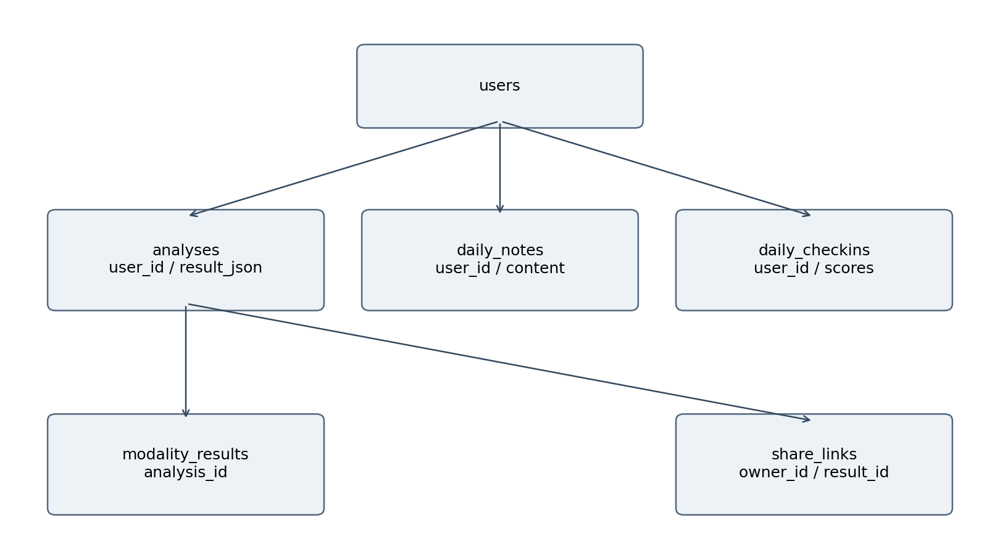
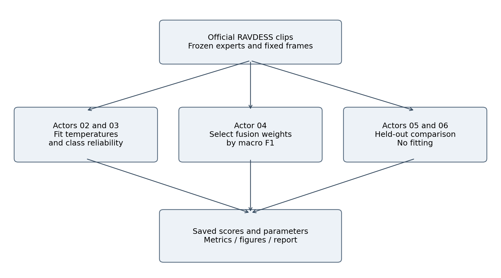
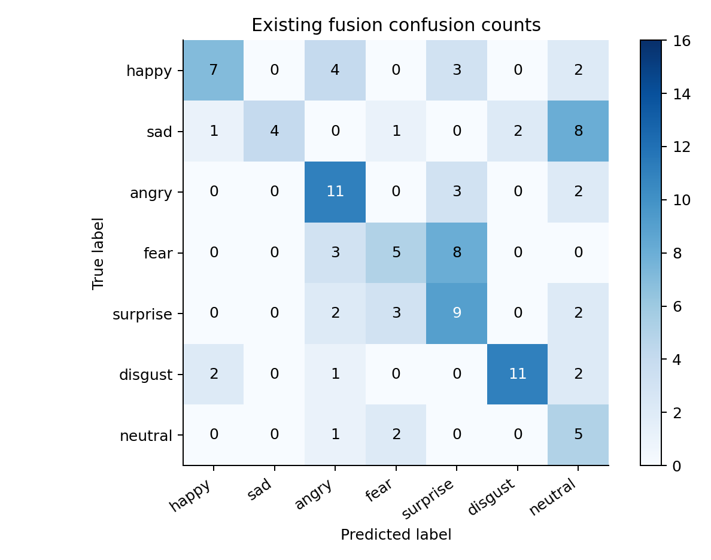
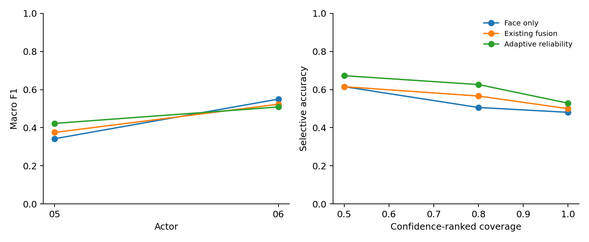
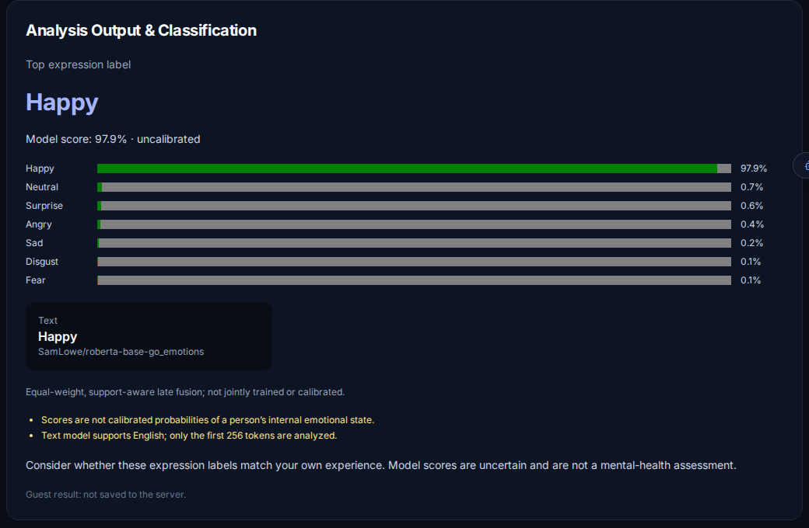

# MindSense

Multimodal Emotion Detection and Mental Health Monitoring

Final year Bachelor of Technology project report

Mohammad Tabrez Alam

Artificial Intelligence and Data Science

Galgotias College of Engineering and Technology

Graduating batch 2027

17 November 2026

<!-- PAGEBREAK -->

## Abstract

MindSense brings text, speech and facial-expression analysis into a single web application. Users can compare predictions, keep private journals and record their own daily check-ins. The application combines published classifiers through late fusion: each model processes its input separately, and the backend combines their scores. This report describes the implementation and investigates a practical question raised during evaluation: why did adding speech sometimes make the facial prediction worse?

The saved prediction records show that the text model achieved 43.72% accuracy and 0.270 macro F1 on 2,610 MELD test utterances. This was below the 48.12% accuracy of always predicting neutral. On 52 RAVDESS clips from Actor 01, face-only inference achieved 40.38% accuracy and 0.392 macro F1, compared with 38.46% and 0.355 for audiovisual fusion. Adding speech corrected one face-only error but introduced two. The speech model was also evaluated on 28 clips belonging to the four classes it supports; that result uses a different sample set from the seven-class comparison.

One issue lies in the models' different output labels. The speech model predicts four classes, whereas the facial model predicts seven. The existing fusion rule averages scores over whichever models provide each label, then normalizes the result. This changes the probability assigned to the three classes that speech cannot predict. The mathematical effect can be shown directly, although the Actor 01 labels alone cannot establish how much of the accuracy loss it caused.

The follow-up uses 260 real clips with separate actors for fitting, validation and testing. On 104 test clips, adaptive class-reliability fusion achieved 52.88% accuracy and 0.5148 macro F1. Existing fusion achieved 50.00% and 0.4933, while face-only inference achieved 48.08% and 0.4848. Validation selected no entropy contribution. Results varied between actors, calibration measures were mixed and the two-actor uncertainty interval included zero. The study therefore reports a small improvement on this subset, without claiming a new algorithm or a general advantage. The application remains an educational expression-analysis tool rather than a clinical assessment system.

## Project overview

| Evidence | Status in this report |
| --- | --- |
| Serving implementation | Serving base a2d7b8e; original protocol 03fc2fd; restored procedure ceb03a1 |
| MELD and Actor 01 metrics | Recomputed from committed prediction labels; no new model inference |
| Actor 02 to 06 follow-up | Exact procedure restored from execution transcript; fresh inference and metrics retained |
| Browser and regression checks | CI logs and screenshot artifact recovered for the inspected commit |

The chapters connect the application design to its evaluation: how the models are used, where the original fusion lost accuracy, and whether a revised rule performs better on separate actors. The initial Actor 01 analysis and the later experiment have different purposes, so their results are reported separately.

<!-- PAGEBREAK -->

## Contents

Abstract and project overview

Introduction and research objectives

1 Related work and project contribution

2 Implemented system

System architecture and implementation details

3 Fusion mathematics and failure hypothesis

4 Verified evaluation method and results

5 Error analysis on Actor 01

6 Actor separated experiment

7 Browser evidence and software verification

8 Security privacy and ethical considerations

9 Discussion limitations and conclusion

References

Appendix A Reproduction and provenance

Appendix B Algorithm and evidence map

<!-- PAGEBREAK -->

## Introduction and research objectives

Words, tone of voice and facial expressions do not always convey the same message. A short sentence may sound reassuring in text while its delivery suggests frustration. MindSense lets users inspect predictions from these channels together and reflect on them through private journals and check-ins. In the project title, mental health monitoring refers to these self-reported records over time. The classifiers do not diagnose depression, anxiety or other mental-health conditions.

Connecting a classifier to a web page is only one part of the engineering problem. The application also needs to handle unavailable model files, reject invalid inputs, protect each user's journal and prevent shared links from exposing unrelated records. For this reason, model provenance, input limits, authentication, ownership, persistence, consent, error recovery and reproducible setup are treated as core requirements.

The research question came from a negative result in the first evaluation. Combining audio and face predictions produced one fewer correct answer than face-only inference on Actor 01. This made it necessary to check the fusion rule rather than assume that a second modality would help. The two models also recognise different class sets and were trained in different domains, so their confidence scores cannot be assumed to have the same meaning.

The study has four objectives. First, it examines how the existing averaging rule changes the distribution of scores. Second, it compares a rule that preserves the facial model's probability mass with individual models, ordinary averaging and calibration controls on the same clips. Third, it checks whether learned class reliability helps more than a constant audio weight and whether an entropy term adds value. Finally, it measures variation between actors, prediction uncertainty and performance when a modality is missing or its scores are altered.

Reliability weighting may also fail: a model can be confidently wrong, and reliability estimated from a few actors may not transfer to another person. A tie or a loss against a simpler method therefore remains a useful result. The experiment is designed to produce a comparison that can be repeated and examined, rather than to guarantee a positive outcome.

### Scope and acceptance criteria

The application includes text, speech and facial inference, registration and login, journals, check-ins, history, dashboards, sharing, export and deletion. The follow-up experiment uses audio and video only. RAVDESS repeats semantically neutral statements, which makes their text unsuitable for evaluating seven-class text-emotion recognition. The three-input application path has been tested, but the predictive benefit of combining all three inputs has not been measured on an aligned dataset.

| Requirement | Verification approach |
| --- | --- |
| Trained-model provenance | Pinned repositories and revisions in the inference registry |
| No fabricated predictions | Missing-model failure tests and real inference collection |
| Private ownership | Cross-account API regression tests |
| Controlled comparison | Identical held-out score records for all seven methods |
| Separation of data roles | Fixed fitting, validation and test actor identifiers |
| Honest reporting | Negative actor-level and calibration findings retained |

The project deliverables are the application, the fusion experiment, saved scores and hashes, reproduction scripts and this report. Clinical validation, a public deployment and a claim of state-of-the-art performance fall outside the completed work.

<!-- PAGEBREAK -->

## 1 Related work and project contribution

Multimodal emotion recognition uses more than one source of information, commonly speech and facial expression. The choice of dataset affects what a result can demonstrate. RAVDESS contains controlled, acted audiovisual recordings [1], while MELD contains conversations with text, audio and video [2]. Their settings and task structures differ, so their scores are not interchangeable. The MELD experiment in this project uses only its text.

Guo and colleagues describe temperature scaling as a post-processing method for calibrating confidence [3]. Tellamekala and colleagues take a different approach in COLD Fusion: they learn modality-specific latent distributions and use calibration and ordinal-ranking constraints to model uncertainty [4]. MindSense instead works with final scores from frozen classifiers. COLD Fusion is therefore discussed as related work, not presented as an implemented numerical baseline.

The contribution of MindSense is the integration of pinned published models, explicit label mapping, an inspectable fusion rule and an evaluation of that rule. The experimental adapter extends this implementation. Its value is in showing what happens with these models under a fixed comparison; a gain on two actors is insufficient to establish a new algorithm or a general advantage over existing research.

### Foundations and comparison with existing approaches

Baltrusaitis, Ahuja and Morency distinguish representation, translation, alignment, fusion and co-learning in their taxonomy of multimodal learning [8]. MindSense belongs to the late-fusion category because it combines classifier outputs. It does not learn a shared representation during application inference. Although older cross-attention modules remain in the repository, the active API does not execute them.

The speech model builds on wav2vec 2.0, which learns representations using masked latent features and a contrastive objective [9]. The checkpoint used here adapts that model family to emotion classification. The foundational paper's speech-recognition results explain the architecture, but they do not measure this checkpoint's performance on RAVDESS. That performance must be tested with the project's own input pipeline.

The facial model uses a Vision Transformer, following the image-patch classification approach described by Dosovitskiy and colleagues [10]. Its expression-classification checkpoint receives a detected and cropped face. A midpoint frame from an acted video may differ from its fine-tuning images, and detection or cropping can affect the result before classification begins. Evaluation therefore includes the application's complete image-processing path.

GoEmotions provides fine-grained emotion labels for English Reddit comments [11]. MindSense groups these labels into seven categories and uses the highest score in each group before normalization. This avoids summing more evidence merely because a group contains more labels, but it does not learn an alignment between datasets or calibrate the scores. The MELD test evaluates the resulting adapter one utterance at a time, without conversational history.

The experimental controls separate the effects of several choices. Fixed-weight averaging checks what happens when another model is added. Temperature scaling changes score sharpness, but cannot create an output class that a model lacks. The hierarchy preserves probability mass across label groups, while class reliability changes the audio weight according to the predicted category. Testing these choices separately makes it possible to identify which ones contribute to the measured result.

| Method family | What it models | Evaluation status here |
| --- | --- | --- |
| Face and audio separately | Individual frozen expert outputs | Executed controls |
| Equal score averaging | Fixed combination of final scores | Executed controls |
| Temperature scaling | Confidence sharpness | Fitted control |
| Hierarchical fusion | Shared and unsupported label mass | Executed adaptation |
| Class reliability and entropy | Predicted class precision and score concentration | Validation-selected variant |
| COLD Fusion | Calibrated ordinal latent distributions | Literature comparison only |

### Research gap and study questions

The gap addressed here is specific to MindSense: there was no evaluation on separate actors showing whether the application's different label spaces and uncalibrated scores helped or harmed classification. Reliability-aware fusion already has a research history. This study examines a lightweight adaptation of the actual frozen models, compares it with simpler alternatives and reports the cases where it fails. It does not claim that the combination has never appeared elsewhere.

The main comparison is between adaptive fusion and the application's existing rule on identical test clips. Face-only inference, calibration and static weighting show whether any improvement depends on adaptation. Results are also broken down by actor because an overall gain can conceal a decline for one person. Missing-input and score-perturbation checks examine specific failure conditions without claiming to cover every real-world disturbance.

<!-- PAGEBREAK -->

## 2 Implemented system

The application uses a React frontend and a FastAPI backend. For each analysis, the backend preprocesses the available inputs, runs locally loaded models and applies late fusion to their scores. A lock allows one inference operation at a time within the supported single process. The active API uses this service rather than the older cross-attention research network [R1, R2].

| Input | Published model | Serving interpretation |
| --- | --- | --- |
| English text | SamLowe/roberta-base-go_emotions | Sigmoid outputs grouped into seven labels using group maxima, then normalized |
| Speech at 16 kHz | superb/wav2vec2-base-superb-er | Softmax scores for happy, sad, angry and neutral |
| One facial image | trpakov/vit-face-expression | Softmax scores for seven expression classes after face detection and cropping |

The model cards identify GoEmotions, IEMOCAP/SUPERB and FER2013 as the respective task data [5-7]. Appendix A records the exact model revisions. Published model-card scores describe their source evaluations; the results in this report come from the MindSense evaluations.

Text is limited to the first 256 tokens. Audio is decoded to 16 kHz and accepted between 0.1 and 30 seconds. Facial analysis requires exactly one detectable frontal face. These constraints affect coverage and should be reported alongside accuracy.

Guest analyses are returned without being saved. For signed-in users, history stores result metadata and scores. Journals and check-ins are separate records that users choose to save. The analysis path does not persist raw text, photographs or recordings. The main storage limitations are that SQLite is not encrypted by the application and browser bearer tokens are stored in localStorage [R2].

<!-- PAGEBREAK -->

## System architecture and implementation details

### Runtime architecture

The React and TypeScript frontend calls /api routes on the same origin. During development, Vite forwards these calls to FastAPI; in the container, FastAPI also serves the built frontend. The backend validates identity and input, then runs CPU inference in a worker thread protected by a process-local lock. The documented setup uses one process rather than a cluster of inference workers.

Figure 1. Runtime components derived from the serving code. The experiment does not replace the application fusion rule.

Setup downloads the models before they are used. At inference time, files are loaded locally and remote model code is disabled. The registry specifies each revision, weight filename, label alias and text grouping. The model-status endpoint distinguishes files being present from a model loading successfully. The health endpoint checks that the service is running; it cannot by itself confirm that prediction works.

### Active database design

The active routes store data in SQLite through database.py and parameterized queries. SQLAlchemy declarations also exist in the repository, but the running routes use the schema managed by database.py. Initialization adds required columns to existing local databases, including result_json and fields used to invalidate older authentication tokens.

Figure 2. Core owner and result relationships in the active SQLite implementation. Ancillary developer and feedback tables are omitted from this focused diagram.

| Table | Stored purpose | Ownership relationship |
| --- | --- | --- |
| users | Identity profile salted password hash auth version | Account identity |
| analyses | Summary and full result JSON | user_id |
| modality_results | Individual expert summaries | analysis_id |
| daily_notes | Journal title content and mood tag | user_id |
| daily_checkins | User-reported scores and optional notes | user_id |
| share_links | Token result expiry revocation | owner_id and result_id |
| login_sessions | Login history | user_id |

The database records who owns each saved analysis and retains its model scores. Raw analysis inputs are not inserted by this path; journal content and check-in notes are stored through their own features. Account deletion explicitly removes the relevant user records and sharing access instead of relying only on nullable foreign keys.

### Frontend and API integration

The analysis screen shows which checkpoints are available and lets the user choose one or more inputs. It displays consent requirements, loading progress, errors, individual scores and warnings when the models disagree. Input controls explain file-size, resolution, text-length and audio-duration limits. Recording and camera capture release their media streams after use. Session restoration and hash routing allow a page refresh without losing the current route, while private routes require login.

Journal entries can be saved, retrieved after a reload and deleted. Check-ins record values reported by the user; the application does not generate a mental-health score from them. Dashboards summarise the stored records. A scripted guide helps users navigate the application, and an educational game illustrates emotion categories. Neither feature supplies benchmark labels or clinical assessments.

API responses use a consistent success/error structure. Analysis requests are multipart because they can contain files, while account and journal endpoints accept structured bodies. The backend obtains identity from a validated bearer token and checks ownership before reading, deleting, exporting or sharing a private record. Supplying another user's identifier is not sufficient to gain access.

### Authentication and sharing

Passwords use salted PBKDF2-SHA256. Signed tokens require the expected algorithm, expiry, account type and current authentication version. Logout revokes the session token; password changes and resets invalidate prior versions. Password reset tokens are hashed, expire after 30 minutes and are single use. Production recovery requires configured SMTP and does not disclose the reset token in the API response.

Only the signed-in owner can create or revoke a link to a saved result. Each link contains a random bearer token and has an expiry time. While active, it allows anyone holding the link to view that result, but does not expose journals or raw inputs. Clearing history or deleting the account removes the associated access. Users must therefore treat an active link as something that can be forwarded.

### Deployment preparation

The repository contains a Dockerfile, compose configuration, environment example, administrator creation script and Windows setup instructions. Model files and SQLite data need persistent storage. Production requires an explicit signing secret. Local development generates a private key file. No default production accounts are created.

CI verifies that the container starts and serves the application. A deployment still needs its own checks for load, TLS termination, encrypted volumes, backup restoration, retention and live email. A health check cannot establish capacity or compliance requirements. The project has not been merged or deployed as part of this report.

<!-- PAGEBREAK -->

## 3 Fusion mathematics and failure hypothesis

Let L contain happy, sad, angry, fear, surprise, disgust and neutral. Let S be the audio-supported subset containing happy, sad, angry and neutral, and let U = L minus S. Write a(k) for normalized audio scores on S and b(k) for normalized face scores on L.

The serving rule averages each label only across modalities that expose that label and then normalizes the resulting vector [R1]. With audio and face present, the pre-normalization score is:

    r(k) = (a(k) + b(k)) / 2     for k in S
    r(k) = b(k)                  for k in U

Define u = sum of b(k) over U. Since audio sums to one over S and face sums to one over L, the normalization constant and final score are:

    Z = 1 + u / 2
    p(k) = r(k) / Z
    sum over U of p(k) = u / (1 + u / 2)

For 0 < u <= 1, the final probability mass on unsupported classes is smaller than the original face-only mass u. Normalization therefore changes the balance between the supported and unsupported groups. This follows from the formula itself, regardless of the dataset. It is also different from padding audio with three zeros and taking an equal-weight average, which would assign mass u/2 to unsupported classes.

For a numerical illustration, suppose face scores are happy = 0.55 and fear = 0.45, while audio assigns happy = 1. The existing rule gives fear a final score of 0.45/1.225, or approximately 0.3673. These are constructed values used to explain the equation, not outputs from an evaluated clip.

### Preserving probability across label groups

An alternative is to keep the face model's probability mass on unsupported classes and let audio redistribute only the supported portion. For an audio weight w between zero and one:

    q(k) = b(k)                                  for k in U
    q(k) = (1-w)b(k) + w(1-u)a(k)                 for k in S

This distribution remains non-negative and sums to one. When w = 0, it returns face-only classification. When w = 1, audio determines the allocation of the supported mass 1-u. It remains defined even when u = 1. The experiment applies this hierarchy to temperature-scaled probabilities and tests it against the other methods.

The hierarchy still relies on the facial model to decide how much probability belongs to S and U. If that split is wrong, preserving it also preserves the mistake. Temperature and reliability parameters must therefore be fitted on development data, and the final comparison must determine whether the method is useful in practice.

<!-- PAGEBREAK -->

## 4 Verified evaluation method and results

The text evaluation uses all 2,610 rows of the official MELD test CSV. It maps joy to happy, sadness to sad and anger to angry, then processes each utterance without dialogue context. The resulting score measures transfer through the seven-label adapter; the model was not trained on MELD for this project [R3, R4].

For RAVDESS Actor 01, the evaluator selects full audiovisual speech files, excludes calm, reads a fixed midpoint frame and runs audio and face inference on the same clip. The report records 52 eligible clips and no decoding or face-detection failures. Speech metrics retain only 28 clips whose true label belongs to S. No new model fitting is performed by this evaluator [R3, R5].

| Dataset and method | Clips or utterances | Classes | Accuracy | Macro F1 |
| --- | --- | --- | --- | --- |
| MELD text adapter | 2,610 | 7 | 43.72% | 0.270 |
| MELD majority neutral | 2,610 | 7 | 48.12% | Not reported here |
| Actor 01 speech | 28 | 4 | 46.43% | 0.366 |
| Actor 01 face | 52 | 7 | 40.38% | 0.392 |
| Actor 01 existing fusion | 52 | 7 | 38.46% | 0.355 |

Accuracy counts the proportion of correct labels. Macro F1 gives each class equal weight by averaging its F1 score over the fixed class set. The verification script rebuilds the confusion matrices and per-class precision, recall, F1 and support from the saved predictions, then compares them with the recorded metrics. This checks the calculations; rerunning model inference from the media is a separate step.

The text model falls 4.41 percentage points below the majority-neutral baseline. Its macro F1 and class-level errors provide additional information, but do not remove that accuracy deficit. On Actor 01, face-only inference gets 21 of 52 clips correct and fusion gets 20. Speech gets 13 of its 28 supported-class clips correct. Because its labels and sample set differ, the higher speech percentage cannot be interpreted as a direct win over face-only inference.

Figure 3. Recomputed confusion matrices for the same 52 Actor 01 clips. Rows are true labels and columns are predicted labels. These counts reproduce the committed reports; they are not new inference.

<!-- PAGEBREAK -->

## 5 Error analysis on Actor 01

Fusion and face agree on 48 of 52 predicted labels. They are both correct on 19 clips and both wrong on 30. Two clips move from a correct face prediction to an incorrect fusion prediction; one moves in the opposite direction. The fourth changed decision remains incorrect.

| RAVDESS filename | True | Face | Fusion | Change |
| --- | --- | --- | --- | --- |
| 01-01-04-02-01-02-01.mp4 | sad | sad | neutral | Introduces error |
| 01-01-05-01-01-02-01.mp4 | angry | neutral | angry | Corrects error |
| 01-01-06-02-02-02-01.mp4 | fear | disgust | angry | Both wrong |
| 01-01-07-01-02-01-01.mp4 | disgust | disgust | neutral | Introduces error |

The net loss is one correct prediction, equivalent to -1.92 percentage points. The error table helps explain this small difference more precisely than a general statement that fusion fails. Of the two newly incorrect predictions, sad is a class supported by audio and disgust is not. These records do not establish label mismatch as the sole cause of either error.

| Class | Support | Face F1 | Existing fusion F1 |
| --- | --- | --- | --- |
| happy | 8 | 0.857 | 0.857 |
| sad | 8 | 0.222 | 0.000 |
| angry | 8 | 0.667 | 0.706 |
| fear | 8 | 0.000 | 0.000 |
| surprise | 8 | 0.222 | 0.222 |
| disgust | 8 | 0.533 | 0.462 |
| neutral | 4 | 0.242 | 0.235 |

The initial reports save top labels and file hashes, but not complete per-modality score vectors for every clip. They allow paired correctness analysis and reconstruction of confusion matrices. Alternative fusion probabilities, temperature scaling, expected calibration error and negative log-likelihood require the full scores, so these cannot be recovered from those labels alone. The follow-up collector retains the score vectors needed for these analyses.

Actor 01 was used to investigate the failure and form the hypothesis. It was therefore excluded from the later fitting, validation and test partitions. After examining the Actor 05 and 06 results, those actors likewise cannot be treated as untouched test data for a newly redesigned method.

<!-- PAGEBREAK -->

## 6 Actor separated experiment

### Dataset roles and preprocessing

The protocol assigns Actors 02 and 03 to fitting, Actor 04 to validation, and Actors 05 and 06 to testing. Actor 01 is left out because its errors were used to develop the hypothesis. This is a project-defined subset, not an official RAVDESS split. From each official Video_Speech_Actor archive, the collector keeps audiovisual speech filenames beginning 01-01 and excludes calm without relabelling it as neutral. Each actor supplies 52 clips: four neutral and eight for each of the other retained classes. The test set therefore contains eight neutral clips and sixteen for each other class. Repeated statements, intensities and takes create dependence within an actor; 104 clips do not represent 104 independent people.

For each clip, the collector extracts the midpoint frame, converts it from BGR to RGB and passes it through the same one-face cropper and classifier used by the application. Audio comes from that clip and is converted to mono at 16 kHz. It must contain finite, audible samples and last between 0.1 and 30 seconds. Frame selection does not use the emotion label, and a failed input is recorded rather than replaced with a more favourable example. Each record contains the actor, true label, filename, SHA-256 hash and either model outputs or an error. All methods are compared on the same successfully processed pairs.

Figure 4. Actor boundaries separate fitting, selection and final evaluation.

### Frozen models and architecture

The experiment uses published checkpoints with their neural weights fixed. The speech configuration is Wav2Vec2ForSequenceClassification: 12 transformer layers, 768 hidden dimensions, 12 attention heads and a 256-dimensional classifier projection. The facial configuration is ViTForImageClassification: 12 layers, 768 hidden dimensions, 12 heads, a 224-pixel input and 16-pixel patches. These specifications are taken from the downloaded configuration files. The application also uses a RoBERTa multi-label text classifier, but text is outside this audiovisual experiment.

Audio and image use softmax over their respective logits. Label aliases are explicitly mapped by name. Text uses sigmoid over its original fine-grained labels, then group maxima and normalization. The canonical seven-label order is happy, sad, angry, fear, surprise, disgust, neutral. The audio order used in the experiment is happy, sad, angry, neutral.

Only the post-processing temperatures and class-reliability estimates are fitted; the neural weights are not updated. After the earlier local artifacts were lost, the original procedure was restored from the execution record and committed as ceb03a1 before rescoring. Its search grid and objective were unchanged. The resulting run reproduces an already observed experiment rather than providing a new independent test.

### Temperature and empirical reliability

Temperature scaling converts each model score p_c into a value proportional to max(p_c, 10^-12) raised to 1/T, then normalizes the values. The candidates are 0.5, 1, 2 and 4. The temperature with the lowest fitting-set negative log likelihood is selected. Audio fitting uses only true labels that the speech model supports; face fitting uses all labels. A positive temperature keeps an individual model's class order unchanged, although the changed scores can affect a fusion decision.

Class reliability estimates how often a predicted category was correct in the fitting data. The estimate is r_c = (1 + correct predictions of c) / (2 + total predictions of c), equivalent to Beta(1,1) smoothing of precision. A class that is never predicted receives 0.5. For audio, this estimate is conditional on supported true labels; it may therefore be optimistic when the model is used within the full seven-class task.

### Hierarchical and adaptive fusion

Let m denote the calibrated facial probability mass on the four labels in S. The hierarchy keeps the facial scores outside S. Within S, it returns m[(1-w) times normalized face scores on S + w times audio scores]. Audio can change which supported label is preferred without changing the total mass assigned to that group. The constant weight w is selected by validation macro F1 from 0, 0.25, 0.5, 0.75 and 1.

Adaptive weighting uses the predicted class reliability together with a measure of score concentration. Entropy is H(p) = -sum p_c log p_c. For a model with K outputs, define Q = r_argmax(p) times max(1-H(p)/log(K), 10^-6)^gamma. The audio weight for a sample is alpha Q_audio / [alpha Q_audio + (1-alpha)Q_face], with a numerical floor on the denominator. Validation searches the same five alpha values and gamma values 0, 1 and 2. Ties select the first grid value deterministically. Gamma zero removes the entropy term; alpha zero returns calibrated face-only inference.

Seven methods are compared: face-only, audio-only padded to seven labels, the existing support-aware average, an ordinary average with zero-padded audio, calibrated face-only, a constant-weight hierarchy and adaptive reliability weighting. The audio-only control is scored against all seven true categories so that every method has the same denominator. Its inability to predict three classes is counted as part of its error.

### Metrics robustness and uncertainty

Accuracy is exact top-label correctness. Macro F1 averages all seven per-class F1 values with zero for undefined classes. Confusion matrices use true labels as rows and predicted labels as columns. NLL averages -log p_true with a 10^-12 floor. The multiclass Brier score sums squared errors over classes before averaging examples; it is not divided by seven.

Expected calibration error (ECE) divides maximum confidence into ten equal-width bins. It sums each bin's frequency multiplied by the absolute gap between accuracy and confidence. Selective accuracy instead orders examples by maximum score and retains approximately 50%, 80% or 100% of them. This shows how accuracy changes when lower-confidence cases are excluded, but does not establish a clinical rejection threshold. Entropy measures how concentrated a score vector is, rather than every source of model uncertainty.

When audio is missing, the method returns calibrated facial scores. When the face is missing, it returns raw audio scores padded to seven labels. A further stress condition replaces calibrated audio probabilities with 0.5a + 0.5/4, moving them towards a uniform distribution. The selected parameters remain fixed. This tests a known change to the scores; it does not simulate physical microphone noise, compression or facial occlusion.

The uncertainty calculation resamples the two test actors with replacement for 1000 replicates using seed 20261116. Each actor's clips stay together, and each replicate measures adaptive-minus-face macro F1. Pairing the methods preserves their comparison on the same samples. However, two actor clusters provide a very limited basis for resampling, so the interval is descriptive and cannot support a population-level significance claim.

### Completed sample counts and selected parameters

| Role | Actors | Complete samples |
| --- | --- | --- |
| Fitting | 02 and 03 | 104 |
| Validation | 04 | 52 |
| Test | 05 and 06 | 104 |

Recorded input failures: 0. No random predictions, replacement weights or fabricated labels were used.

| Parameter | Selected value |
| --- | --- |
| audio_temperature | 4 |
| face_temperature | 2 |
| static_audio_weight | 0 |
| adaptive_prior | 0.75 |
| entropy_power | 0 |

### Baseline comparison on identical held out samples

| Method | Validation F1 | Test accuracy | Test macro F1 |
| --- | --- | --- | --- |
| Face only | 0.5171 | 48.08% | 0.4848 |
| Audio only seven labels | 0.1228 | 24.04% | 0.1572 |
| Existing fusion | 0.5013 | 50.00% | 0.4933 |
| Zero padded average | 0.4114 | 48.08% | 0.4585 |
| Calibrated face | 0.5171 | 48.08% | 0.4848 |
| Hierarchical static | 0.5171 | 48.08% | 0.4848 |
| Adaptive reliability | 0.5647 | 52.88% | 0.5148 |

Figure 5. Same-sample accuracy and macro F1 for the seven methods.

Adaptive reliability classified 55 of 104 clips correctly; existing fusion classified 52, and face-only classified 50. The adaptive change over existing fusion is 2.88 percentage points in accuracy and 0.0216 in macro F1. The gain is small and needs to be considered alongside the actor-level results below.

Validation chose zero audio weight for the static hierarchy, making it identical to calibrated face-only inference. It also chose an entropy exponent of zero for adaptive fusion. The selected adaptive method therefore uses class reliability without an entropy contribution; these results provide no evidence that the entropy term helped.

Existing fusion damaged 5 correct facial decisions and repaired 7 wrong ones on these test actors. Its disagreement rate with face-only was 23.08%. In contrast to Actor 01, existing fusion has a net gain over face-only inference on these actors. The effect of the normalization rule can be derived mathematically, but these results do not establish it as the cause of every error.

Figure 6. Face-only confusion counts for Actors 05 and 06.

Figure 7. Existing fusion on the same held-out records.

Figure 8. Adaptive reliability on the same held-out records.

### Actor variation and score uncertainty

| Actor | Face F1 | Existing F1 | Adaptive F1 |
| --- | --- | --- | --- |
| 5 | 0.3421 | 0.3751 | 0.4225 |
| 6 | 0.5500 | 0.5233 | 0.5088 |

Adaptive fusion improves macro F1 for Actor 05. For Actor 06, it performs worse than both face-only inference and existing fusion. The overall improvement is therefore not consistent across the two actors.

The descriptive actor-bootstrap 95% interval for adaptive-minus-face macro F1 is [-0.0412, 0.0804]. The interval includes zero. With only two test actors, it is too unstable to establish a population advantage or statistical significance.

| Method | NLL | Brier | ECE |
| --- | --- | --- | --- |
| Face only | 2.0496 | 0.8087 | 0.3293 |
| Audio only seven labels | 13.7660 | 1.2259 | 0.5414 |
| Existing fusion | 1.7142 | 0.6816 | 0.0718 |
| Zero padded average | 1.8293 | 0.7297 | 0.1036 |
| Calibrated face | 1.4936 | 0.6860 | 0.1421 |
| Hierarchical static | 1.4936 | 0.6860 | 0.1421 |
| Adaptive reliability | 1.3429 | 0.6324 | 0.1243 |

Adaptive fusion has lower NLL and Brier loss than existing fusion, but higher ECE. The calibration measures therefore give a mixed result. As expected, temperature scaling leaves the face-only top labels unchanged.

Figure 9. Actor variation and confidence-ranked selective accuracy.

<!-- PAGEBREAK -->

### Prespecified stress conditions

| Condition | Accuracy | Macro F1 |
| --- | --- | --- |
| missing audio | 48.08% | 0.4848 |
| missing face | 24.04% | 0.1572 |
| uniform audio contamination adaptive | 54.81% | 0.5421 |
| uniform audio contamination static | 48.08% | 0.4848 |

Moving the audio scores towards a uniform distribution improves the adaptive result in this test. This was observed after evaluation and was not used to retune the method. Because the selected entropy power is zero, the result cannot be credited to entropy-based rejection of unreliable audio. Without the face input, performance remains poor because the speech model cannot predict three of the target classes.

### Research finding and serving decision

This experiment contributes an inspectable comparison of the actual models and an adaptation that preserves label-group probability mass while weighting speech by class reliability. It does not introduce uncertainty-aware fusion as a new idea, reproduce COLD Fusion or establish clinical usefulness. Given the mixed findings and small test set, the application keeps its existing fusion rule. The experimental method remains available separately for further evaluation.

<!-- PAGEBREAK -->

## 7 Browser evidence and software verification

Figure 10. Genuine Chromium screenshot from the PR workflow at commit 03fc2fd. The browser artifact also contains mobile-analysis.png and real-text-result.png. Originals are preserved without alteration alongside the report source.

| Check at inspected commit | Verified result |
| --- | --- |
| Backend pytest | 143 passed and 5 skipped |
| Frontend Vitest | 10 passed |
| Browser Playwright | 6 passed |
| Production build and audit workflow | Completed successfully |

The result screenshot shows guest text classified as happy with an uncalibrated score of 97.9%. Audio and image checkpoints were not installed in that browser environment, as the interface indicates. The screenshot documents the text-analysis path; separate API and research runs provide evidence for the other models. At commit ff1fba7, CI passed 149 Python tests: 143 existing backend tests and six research tests, with five legacy tests skipped. The frontend passed 10 tests and its production build; all six Playwright browser tests passed as well. The research tests also passed locally on 17 November. They check probability-mass conservation, limiting weights, temperature ordering, reliability smoothing, equivalence to the application baseline, metrics and actor separation. Test fixtures verify these properties; they are not samples used to measure model accuracy. The screenshots are tied to [R7] and the regression results to [R8].

Figure 11. Actual guest text inference from the preserved CI screenshot; cropped for readability, with original pixels and source image retained.

<!-- PAGEBREAK -->

## 8 Security privacy and ethical considerations

Privacy is central to the application because journal entries and emotion-related inputs can contain personal information. Analyses are private by default, and access to saved records requires an ownership check. Users can export their records or delete them. The benchmark does not use private journals: its cache contains identifiers from public datasets and classifier outputs.

The implementation has limits that matter before public use. SQLite is not encrypted at application level, bearer tokens in localStorage are exposed if cross-site scripting occurs, and rate limits apply within a single process. A host must protect TLS configuration, secrets, volumes, backups and logs. Account deletion removes application records but cannot erase external backup copies; retention policies must address those separately. Automated tests and vulnerability scans cover specific checks, not every security risk.

RAVDESS labels describe acted expressions. They do not establish a person's diagnosis, intention, truthfulness, suitability for work or response to treatment. The predictions should not be used for consequential decisions about a person. The application neither infers sensitive demographic attributes nor claims fairness across groups. Performance across cultures, accents, languages, disabilities, lighting conditions and spontaneous behaviour has not been established.

Model and dataset licenses are separate obligations. Source model-card scores are not project measurements. Raw RAVDESS media are downloaded from the official record and not committed. The data record specifies CC BY-NC-SA 4.0; the article publication license must not be confused with the media license. Human-subject recruitment is inactive unless a legitimate study is separately approved and configured.

<!-- PAGEBREAK -->

## 9 Discussion limitations and conclusion

Adaptive class-reliability fusion improved the overall result on this subset, but the detailed findings qualify that improvement. Static weighting selected no audio contribution, the entropy term was not selected, one actor lost macro F1 and ECE worsened relative to existing fusion. These outcomes show why average accuracy alone is insufficient when deciding whether to replace the application method. The existing default is retained until a larger evaluation establishes a more consistent benefit.

The study uses two actors for fitting, one for validation and two for testing. This leaves substantial uncertainty compared with a full 24-actor evaluation or repeated actor-disjoint cross-validation. The selected settings may depend strongly on the validation actor. The two test actors also provide too few clusters for reliable population inference. Other limitations come from the input pipeline: one midpoint frame discards motion, and the speech model has no fear, surprise or disgust output. Preserving the facial model's group mass cannot correct an error in that group allocation.

The text adapter remains below the majority-neutral accuracy baseline on MELD. Neither an aligned three-way predictive benchmark nor clinical validation has been completed. The original cross-attention research assets are still missing. In addition, published checkpoints limit how fully upstream pretraining overlap can be audited: separating actors within this project does not prove that every upstream training source was independent.

The saved follow-up is a reproduction of an experiment whose results had already been observed. After the original local score files were lost, the exact computational procedure was restored from the execution transcript and committed before inference was rerun. No objective or search grid was changed in response to the test results. The regenerated files are documented as such rather than described as byte-for-byte recovery or new independent evidence.

### Future scope

The next research step is a larger preregistered evaluation with nested actor-disjoint folds. Calibration and parameter selection should stay within each training partition, and any revised method should be assessed on actors not used to guide its design. A seven-class speech model would allow a direct test of the label-support issue. Aggregating several facial frames could also show whether the midpoint-only approach discards useful information. Both changes require a fresh comparison, with appropriate dataset licences.

An aligned conversational dataset could extend evaluation to text, audio and face if speaker partitions, context and labels are handled consistently. A numerical comparison with COLD Fusion would require its training method and a shared evaluation setup. For deployment, the remaining work includes live microphone and camera testing, SMTP delivery, load testing, encrypted storage and backup restoration. These are future tasks, separate from the results reported here.

<!-- PAGEBREAK -->

## References

[1] Livingstone, S. R., and Russo, F. A. (2018). The Ryerson Audio-Visual Database of Emotional Speech and Song (RAVDESS): A dynamic, multimodal set of facial and vocal expressions in North American English. PLOS ONE, 13(5), e0196391. [DOI 10.1371/journal.pone.0196391](https://doi.org/10.1371/journal.pone.0196391).

[2] Poria, S., Hazarika, D., Majumder, N., Naik, G., Cambria, E., and Mihalcea, R. (2019). MELD: A Multimodal Multi-Party Dataset for Emotion Recognition in Conversations. Proceedings of ACL, 527-536. [ACL Anthology](https://aclanthology.org/P19-1050/).

[3] Guo, C., Pleiss, G., Sun, Y., and Weinberger, K. Q. (2017). On Calibration of Modern Neural Networks. Proceedings of ICML, PMLR 70, 1321-1330. [PMLR](https://proceedings.mlr.press/v70/guo17a.html).

[4] Tellamekala, M. K., Amiriparian, S., Schuller, B. W., Andre, E., Giesbrecht, T., and Valstar, M. (2023). COLD Fusion: Calibrated and Ordinal Latent Distribution Fusion for Uncertainty-Aware Multimodal Emotion Recognition. Version 2, accepted to IEEE TPAMI. [arXiv 2206.05833v2](https://arxiv.org/abs/2206.05833v2).

[5] SamLowe. roberta-base-go_emotions model card. [Model documentation](https://huggingface.co/SamLowe/roberta-base-go_emotions).

[6] SUPERB. wav2vec2-base-superb-er model card. [Model documentation](https://huggingface.co/superb/wav2vec2-base-superb-er).

[7] trpakov. vit-face-expression model card. [Model documentation](https://huggingface.co/trpakov/vit-face-expression).

[8] Baltrusaitis, T., Ahuja, C., and Morency, L.-P. (2017). Multimodal Machine Learning: A Survey and Taxonomy. [arXiv 1705.09406](https://arxiv.org/abs/1705.09406).

[9] Baevski, A., Zhou, H., Mohamed, A., and Auli, M. (2020). wav2vec 2.0: A Framework for Self-Supervised Learning of Speech Representations. [arXiv 2006.11477](https://arxiv.org/abs/2006.11477).

[10] Dosovitskiy, A., et al. (2020). An Image is Worth 16x16 Words: Transformers for Image Recognition at Scale. [arXiv 2010.11929](https://arxiv.org/abs/2010.11929).

[11] Demszky, D., Movshovitz-Attias, D., Ko, J., Cowen, A., Nemade, G., and Ravi, S. (2020). GoEmotions: A Dataset of Fine-Grained Emotions. ACL, 4040-4054. [DOI 10.18653/v1/2020.acl-main.372](https://aclanthology.org/2020.acl-main.372/).

The original implementation references R1 to R6 point to commit 03fc2fd978adc071bb8685c1216bd4a03911da0e, inspected on 16 November 2026. Literature and model-card pages were checked on the same date. Model-card metrics are background only.

[R1] MindSense inference [service.py](https://github.com/Mohammadtabrejalam/Emotion-detection-by-using-multi-modal-fusion-mental-health-monitoring./blob/03fc2fd978adc071bb8685c1216bd4a03911da0e/backend/app/inference/service.py) and [registry.py](https://github.com/Mohammadtabrejalam/Emotion-detection-by-using-multi-modal-fusion-mental-health-monitoring./blob/03fc2fd978adc071bb8685c1216bd4a03911da0e/backend/app/inference/registry.py).

[R2] [ARCHITECTURE.md](https://github.com/Mohammadtabrejalam/Emotion-detection-by-using-multi-modal-fusion-mental-health-monitoring./blob/03fc2fd978adc071bb8685c1216bd4a03911da0e/ARCHITECTURE.md).

[R3] [Evaluation method and reproduction instructions](https://github.com/Mohammadtabrejalam/Emotion-detection-by-using-multi-modal-fusion-mental-health-monitoring./blob/03fc2fd978adc071bb8685c1216bd4a03911da0e/docs/EVALUATION_PUBLISHED.md) and [evaluator source](https://github.com/Mohammadtabrejalam/Emotion-detection-by-using-multi-modal-fusion-mental-health-monitoring./blob/03fc2fd978adc071bb8685c1216bd4a03911da0e/scripts/evaluate_published.py).

[R4] [MELD prediction report](https://github.com/Mohammadtabrejalam/Emotion-detection-by-using-multi-modal-fusion-mental-health-monitoring./blob/03fc2fd978adc071bb8685c1216bd4a03911da0e/reports/meld_text.json).

[R5] [Actor 01 prediction report](https://github.com/Mohammadtabrejalam/Emotion-detection-by-using-multi-modal-fusion-mental-health-monitoring./blob/03fc2fd978adc071bb8685c1216bd4a03911da0e/reports/ravdess_actor01.json).

[R6] [Frozen fusion protocol](https://github.com/Mohammadtabrejalam/Emotion-detection-by-using-multi-modal-fusion-mental-health-monitoring./blob/03fc2fd978adc071bb8685c1216bd4a03911da0e/research/fusion_v2/protocol.json).

[R7] [CI run 43871924375](https://github.com/Mohammadtabrejalam/Emotion-detection-by-using-multi-modal-fusion-mental-health-monitoring./actions/runs/43871924375), browser artifact 14227524645, and [companion CI run 43871924186](https://github.com/Mohammadtabrejalam/Emotion-detection-by-using-multi-modal-fusion-mental-health-monitoring./actions/runs/43871924186).

[R8] [Restored-code comprehensive verification](https://github.com/Mohammadtabrejalam/Emotion-detection-by-using-multi-modal-fusion-mental-health-monitoring./actions/runs/44052718924) at ff1fba7, and [container/build workflow](https://github.com/Mohammadtabrejalam/Emotion-detection-by-using-multi-modal-fusion-mental-health-monitoring./actions/runs/44052718377).

[R9] [Preserved real-inference reproduction](https://github.com/Mohammadtabrejalam/Emotion-detection-by-using-multi-modal-fusion-mental-health-monitoring./actions/runs/44052351282), using the restored computational procedure without test-guided changes.

<!-- PAGEBREAK -->

## Appendix A Reproduction and provenance

### Pinned model revisions

| Modality | Exact model revision |
| --- | --- |
| Text | d75048347613a25d77de8cf6412eaae9fa7b26be |
| Audio | 441a7599c3b22107314dcbd9166621c5c83f2cc5 |
| Face | ef0bc6fc34241b6587e7e009e7711357be28c024 |

The committed inference reports record Python 3.12.14, CPU PyTorch 2.15.0, Transformers 5.23.0 and OpenCV 4.11.0.86. The earlier local reproduction records its package versions in research/fusion_v2/environment.json. The preserved GitHub Actions inference run records its installed packages in research/fusion_v2/reproduction_environment.txt [R9]. The published checkpoints were downloaded at the same pinned revisions.

### Numerical verification

From the repository root, run:

    python -m scripts.verify_report_evidence

The standard-library-only verifier writes research/fusion_v2/verified_report_evidence.json. It checks unique prediction identifiers, sample counts, accuracy, macro and weighted F1, per-class statistics and confusion matrices. It also lists the four changed Actor 01 predictions. It does not download datasets, fit models or infer new labels.

Full model evaluation follows [R3]. Dataset media and weights are not distributed with this report. The RAVDESS data record should be consulted for its usage terms; the repository records CC BY-NC-SA 4.0 for the evaluated media. The article's publication license and the dataset license must not be conflated.

### Evidence integrity

The recovered browser ZIP SHA256 matches the artifact digest returned by GitHub:

    7d9e3bce8ffecffba5e4407064b4669d7851a3550836ec792bca2629405e133c

The committed MELD source CSV hash is:

    8d37103938f7067600839fe29d5a114a6cd1bcdafb75bec101e06464c5006888

Exact SHA256 hashes for the saved prediction reports are included in the verifier output. The report source and browser images are preserved with the repository. The follow-up score records, exact experiment source, fitted parameters, metrics, per-actor results and seeded bootstrap generator are now retained under research/fusion_v2. Its RECOVERY.md explains the interrupted artifact history and the rerun boundary.

### Viva questions supported by the evidence

Why did fusion lose accuracy? On Actor 01, adding audio changed two correct facial decisions into errors and corrected one error. The label mismatch changes score allocation as well, but this evaluation does not isolate its contribution to each mistake.

What does the project contribute? It connects real models to a private web application, makes the label adapters explicit and tests the fusion rule on separate actors. Reliability-aware fusion and temperature scaling are established ideas, not inventions of this project.

How strong is the improvement? It is a small overall gain across two test actors. One actor's macro F1 declined and the uncertainty interval crosses zero, so a larger evaluation is needed before claiming a general advantage.

### Research and report execution

    python -m pip install -r research/fusion_v2/requirements.txt
    python -m pytest research/fusion_v2/test_experiment.py -q
    python -m research.fusion_v2.experiment
    python -m scripts.generate_research_report
    python -m scripts.build_academic_report

Cached-score reproduction requires neither neural weights nor raw media. Full reproduction additionally installs backend/requirements-inference.txt, CPU PyTorch and FFmpeg, downloads the pinned experts, archives the current scores.jsonl, and runs python -m research.fusion_v2.collect. RAVDESS_CACHE selects a writable media directory. The default is ignored data/raw/ravdess-fusion-v2. Several gigabytes of temporary storage can be needed while archives download.

The report generator assembles the template with results.json and creates data-derived figures. The DOCX builder converts that complete Markdown source. PDF conversion requires LibreOffice; render all pages and inspect them after a toolchain change. The code, evidence and report outputs are maintained on the existing draft PR. The research reproduction workflow preserves scores and metrics as downloadable artifacts, so the experiment does not depend on a temporary authoring workspace.

<!-- PAGEBREAK -->

## Appendix B Algorithm and evidence map

    1 Read the frozen actor protocol and the actual score cache.
    2 Require unique clip IDs and all prescribed actor records.
    3 Use the same successful audio and face pairs for every method.
    4 Fit temperatures and class reliability on fitting actors only.
    5 Select static and adaptive weights by validation macro F1.
    6 Freeze those settings and compute test metrics by method and actor.
    7 Apply the prespecified missing-input and score-contamination checks.
    8 Compute the seeded paired actor bootstrap without changing parameters.
    9 Save scores, hashes, settings, selection traces and held-out outputs.
    10 Generate report figures and tables from the saved results.

| File | Audit purpose |
| --- | --- |
| protocol.json | Fixed actor allocation grids and evaluation boundary |
| collect.py | Official media collection and actual expert calls |
| scores.jsonl | Per-clip source hash model revision and probabilities |
| experiment.py | Fitting selection metrics and bootstrap procedure |
| results.json | Counts settings validation trace and full test outputs |
| reproduction_check.json | Comparison with prior recorded aggregate values |
| reproduction_environment.txt | Package versions for the preserved CI inference run |
| verification.json | Test commands counts and CI provenance |
| RECOVERY.md | Explanation of the interrupted artifact history |

No test-set outcome is used to select a setting. Future changes should reserve untouched actors rather than repeatedly redesigning against Actors 05 and 06. The small two-actor test remains a limitation even when reproduction is exact.
