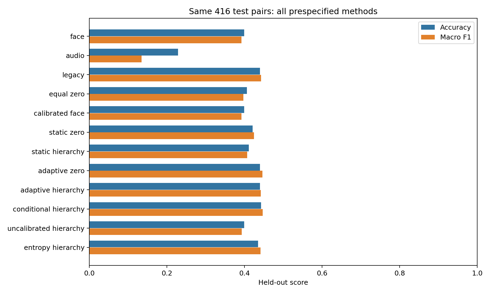
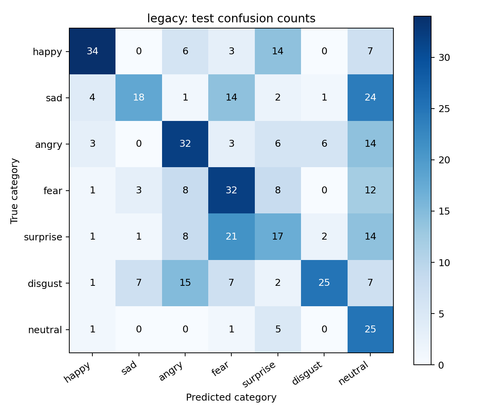
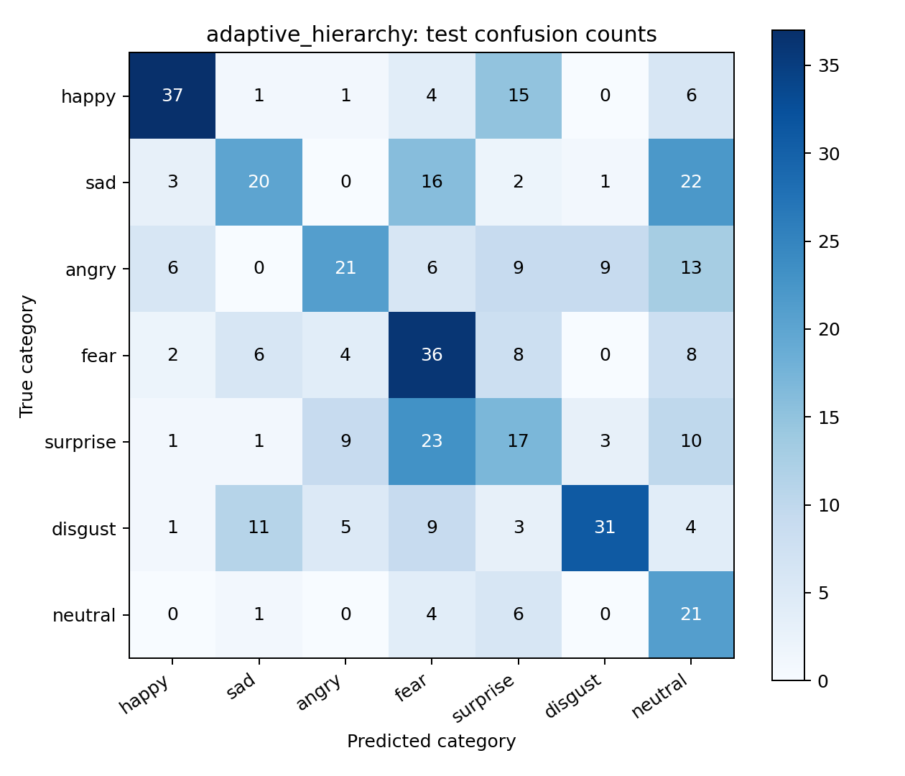
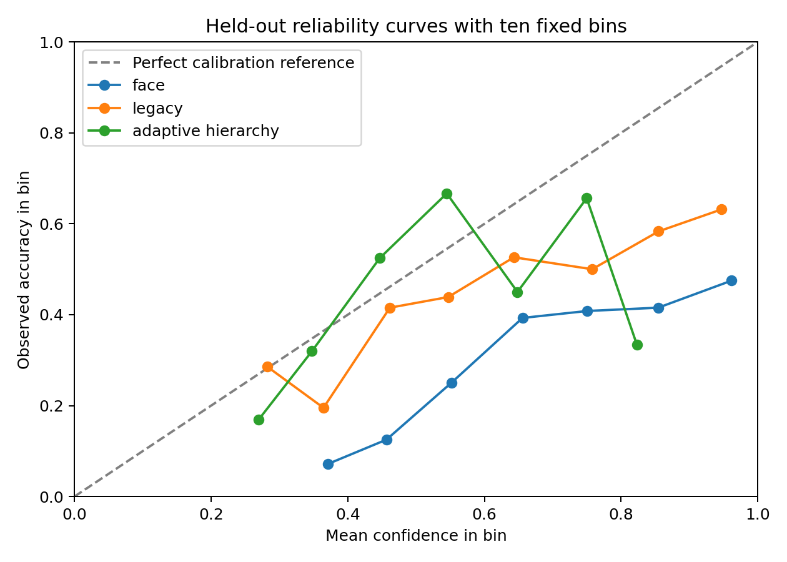
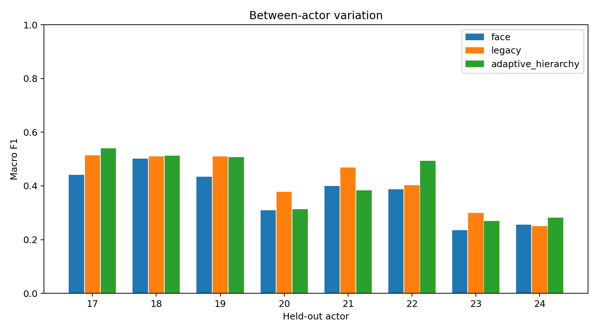

# When Does Late Fusion Help? Evaluating Frozen Emotion Classifiers with Partially Overlapping Label Sets

**Research manuscript — completed single-dataset study. Further validation is required before submission.**

## Abstract

Independently trained emotion classifiers can expose different output categories, making the treatment of absent categories part of the fusion design. We evaluate a frozen four-class speech classifier and a seven-class facial-expression classifier using 936 real RAVDESS clips. Six previously examined actors are excluded; six actors are used for fitting, four for validation and eight for a 416-clip held-out test. Twelve fixed comparisons separate calibration, label handling and reliability weighting. We derive a probability-mass-preserving adapter and show that it is a nested-label special case of existing weighted CTMC fusion, rather than a new fusion algorithm. The primary adaptive adapter and the existing support-based averaging rule both achieve 43.99% accuracy. Their macro F1 scores are 0.4418 and 0.4427 respectively; the paired difference is -0.0009, with an actor-bootstrap 95% interval of [-0.0416, 0.0395] and an exact actor-block permutation p-value of 0.9531. The adapter improves NLL and Brier score but trades better recognition of unsupported speech categories for worse recognition of shared categories. These findings do not support the primary performance-improvement hypothesis. The contribution is a reproducible analysis of this failure mode and its tradeoffs in one frozen-model setting, with explicit limits on novelty and generalization.

## 1. Introduction

A practical multimodal system may reuse models trained by different teams on different datasets. Such models need not predict the same categories. In our case, the speech classifier produces probabilities for happy, sad, angry and neutral, while the face classifier also predicts fear, surprise and disgust. An absent audio category does not mean that the audio establishes that category to be impossible. The classifier simply has no corresponding output.

This distinction matters when combining predictions. Padding the speech distribution with zeros and averaging it with the face distribution reduces the probability assigned to every category missing from speech. Averaging only over modalities that support each category avoids explicit zeros, but its subsequent normalization also changes those categories' total probability. A more careful adapter can retain the face classifier's probability mass for categories outside the speech vocabulary while using speech to redistribute mass within the shared vocabulary.

Preserving that mass is a mathematical property, not a guarantee of more accurate recognition. The face model's mass allocation may itself be wrong. Speech errors may persist after calibration, and reliability learned on a few actors may not generalize. We therefore study the adapter as an empirical hypothesis rather than a new state-of-the-art model.

The application that motivated the study serves as a demonstrator. Its authentication, journaling and dashboard functions are engineering context, not evidence for the research claim. The paper concerns recognition of dataset emotion labels, not diagnosis or measurement of mental illness.

## 2. Related work and research positioning

Temperature scaling is an established calibration method [1]. We use a small fixed temperature grid and make no novelty claim for calibration. COLD Fusion [2] learns latent audiovisual distributions with calibration and ordinal-ranking constraints. It establishes that uncertainty-aware emotion fusion already exists; it is not an implementation-equivalent baseline for our frozen score adapter.

Ahamed et al. [3] compare early, late, hybrid and meta fusion using pretrained encoders on MELD. Consequently, combining frozen pretrained models or comparing fusion strategies is not by itself a new contribution. Our candidate scope is the treatment of partially overlapping output categories in independently trained experts, with a controlled evaluation of what each component contributes.

Li and Lin [7] directly address specialized classifiers whose category sets differ. Their CTMC construction combines class-transition preferences and uses a stationary distribution. This is prior art for the central problem, not merely adjacent multimodal work. Our independent derivation below shows that the mass-preserving rule is a nested-label special case of their weighted construction. We therefore position this work as an empirical study of frozen speech–face fusion, not as the invention of a new fusion algorithm. A useful submission still requires a broader review and evidence beyond this one dataset and checkpoint pair.

The comparisons implemented here are reproducible score-level controls. Results reported in other papers on different datasets, label mappings or subject splits must not be placed in our table as if they were directly comparable. Reimplementing relevant published alternatives under a matched protocol remains further work.

## 3. Research questions

**RQ1:** Does the mass-preserving adaptive adapter outperform the application's existing support-based averaging on unseen actors?

**RQ2:** Does preserving category mass add value beyond calibration and independently tuned ordinary score averaging?

**RQ3:** How much do reliability weighting, excluding unsupported true labels from reliability estimation, and entropy weighting affect the result?

**RQ4:** Are any improvements consistent across actors and probability-quality measures, and what happens when a modality is unavailable or its scores are made less informative?

The primary endpoint is the paired difference in seven-class macro F1 between adaptive hierarchy and the legacy rule. The remaining comparisons are descriptive and cannot be promoted after seeing their outcomes to replace a failed primary comparison.

## 4. Data and frozen experts

RAVDESS contains acted audiovisual expressions from 24 actors and two fixed spoken statements [4]. We use full audiovisual speech clips, exclude calm rather than relabel it, and retain the seven remaining categories. Each actor contributes 52 eligible clips before preprocessing failures: four neutral clips and eight for each other category. Repetitions and intensities from one actor stay in the same partition.

| Partition | Actors | Eligible clips before failures | Purpose |
|---|---|---:|---|
| Excluded development history | 01–06 | Not used | Previously observed results influenced design |
| Fitting | 07–12 | 312 | Temperature and reliability estimation |
| Validation | 13–16 | 208 | Fusion weight and optional entropy selection |
| Test | 17–24 | 416 | One fixed held-out comparison |

All 936 eligible clips completed paired inference: 312 fitting, 208 validation and 416 test clips, with zero recorded input failures. Each held-out actor contributed all 52 clips. The actor split was specified before new collection but is a single fixed partition, not repeated subject cross-validation.

The speech expert is `superb/wav2vec2-base-superb-er`, revision `441a7599c3b22107314dcbd9166621c5c83f2cc5`. Its model card describes the SUPERB IEMOCAP emotion task and 16 kHz input [5]. The facial expert is `trpakov/vit-face-expression`, revision `ef0bc6fc34241b6587e7e009e7711357be28c024`, a ViT model whose card reports FER2013 fine-tuning and seven output categories [6]. Neither checkpoint is retrained in this study. Published model-card metrics are not our evaluation results.

Audio is decoded to mono 16 kHz. The midpoint video frame passes through the existing single-face detector and cropper before model preprocessing. This is a deliberately limited single-frame visual pipeline, not a temporal facial-motion model. The collector records the filename, actor, true category, input SHA-256, checkpoint revisions, probability vectors and any input failure. Both modalities must succeed for a sample to enter a paired comparison. Conditioning on successful face detection can bias the evaluated sample; class and actor coverage must therefore accompany performance.

## 5. Fusion formulation

Let C be the seven-category vocabulary and S the four-category speech vocabulary, with S a subset of C. Let a(c) be the normalized speech distribution on S and v(c) the normalized face distribution on C. Define m = sum over c in S of v(c), and U = C minus S.

### 5.1 Ordinary zero-padded mixture

Extend a with zeros outside S. For audio weight w in [0,1],

\[
q_{zero}(c)=(1-w)v(c)+w\,\tilde a(c).
\]

Its total mass on U equals (1-w)(1-m). At equal weights it halves the face mass outside S, regardless of whether speech contains useful information about those categories.

### 5.2 Existing support-based averaging

The existing rule averages the experts for categories in S, uses the face score alone for U, then normalizes. The pre-normalization total is Z=(3-m)/2. Thus,

\[
q_{legacy}(c)=
\begin{cases}
(v(c)+a(c))/(3-m), & c\in S,\\
2v(c)/(3-m), & c\in U.
\end{cases}
\]

Its mass on U is 2(1-m)/(3-m). This is smaller than 1-m whenever 0<m<1. The rule therefore changes unsupported-category mass even though it does not explicitly pad audio with zeros. This is an algebraic explanation of a possible failure mechanism, not evidence that every prediction becomes worse.

### 5.3 Mass-preserving adapter

We retain the face distribution on U and mix within S:

\[
q_{hier}(c)=
\begin{cases}
(1-w)v(c)+wm a(c), & c\in S,\\
v(c), & c\in U.
\end{cases}
\]

This distribution is nonnegative, sums to one, and preserves both the shared and unsupported total masses. The implementation uses this expression directly, avoiding division by m when m=0. The construction imposes an assumption: the face expert controls the boundary between shared and unsupported categories. It cannot correct an erroneous boundary allocation. It can still change the winning category by concentrating probability within S.

### 5.4 Calibration and reliability

For each expert, temperature transformation is

\[
p_T(c)=p(c)^{1/T}/\sum_j p(j)^{1/T}.
\]

The fitting split selects T from {0.5,1,2,4} by negative log likelihood. Audio temperature fitting uses supported true labels, since the four-class expert has no likelihood for unsupported truths. Values are floored at \(10^{-12}\) for numerical stability.

For predicted class k, a Beta(1,1)-smoothed reliability estimate is

\[
r_k=(1+n_{correct,k})/(2+n_{predicted,k}).
\]

Primary audio reliability includes all fitting samples: an audio prediction on a true unsupported category counts as incorrect. A conditional-reliability ablation estimates it only among supported truths. Reliability is a coarse predicted-class statistic, not a direct measurement of input quality or epistemic uncertainty.

Given a prior audio weight alpha, the adaptive weight is

\[
w(x)=\frac{\alpha r_a(x)}{\alpha r_a(x)+(1-\alpha)r_v(x)}.
\]

The primary method has no entropy term. A secondary ablation multiplies each reliability by \(\max(1-H(p)/\log K,10^{-6})^{\gamma}\), where gamma is chosen from {0,1,2}. A confident distribution can be wrong, so this term must be evaluated rather than treated as a reliability guarantee.

### 5.5 Relationship to existing CTMC fusion

The published construction [7] and the authors' implementation [8] form a weighted sum of class-transition generators. For one full-vocabulary expert and one subset expert, we derive the stationary solution independently. Let q denote the stationary distribution and let the two expert weights be 1-w and w, with w<1. The full expert contributes the vector (1-w)(v-q). The subset expert contributes zero outside S and w(a sum(q_S)-q_S) inside S.

Outside S, stationarity implies q_U=v_U, hence sum(q_S)=m. Inside S it then gives

\[
0=(1-w)(v_S-q_S)+w(ma-q_S),
\qquad q_S=(1-w)v_S+wma.
\]

This is exactly the adapter in Section 5.3. The identity also holds for an input-dependent scalar weight after fixing that input. At w=1, the CTMC need not have a unique stationary distribution because the full expert has no weight; the adapter uses the continuous limit as w approaches one. It should not be described as the unique stationary solution at that endpoint.

An independent NumPy solver checks the identity against stationary equations for deterministic probability fixtures and tests the non-unique endpoint. These are mathematical software checks, not additional emotion-recognition observations. The finding rules out novelty claims for the core mass-preserving rule. Any research value must come from the experimental analysis, justified reliability treatment or another demonstrably distinct contribution.

## 6. Experimental design

Each tunable method independently selects its weight from {0,0.25,0.5,0.75,1} by validation macro F1. The first grid entry wins a tie. The fixed protocol specifies all twelve methods:

| Method | What it tests |
|---|---|
| Raw face | Strong unimodal control |
| Raw audio, padded | Four-class expert under the seven-class task |
| Legacy rule | Existing application's fusion behavior |
| Equal zero-padded average | Conventional equal mixture |
| Calibrated face | Probability calibration alone |
| Static zero-padded mixture | Tuned mixture without hierarchy |
| Static hierarchy | Mass preservation without adaptive reliability |
| Adaptive zero-padded mixture | Reliability and calibration without hierarchy |
| Adaptive hierarchy | Prespecified primary method |
| Conditional-reliability hierarchy | Effect of excluding unsupported audio truths |
| Uncalibrated hierarchy | Effect of temperature scaling |
| Entropy hierarchy | Additional entropy weighting |

The `fit` command reads only fitting and validation actors. It produces selected parameters, the full validation trace, coverage, input hashes and the protocol hash. Test collection in CI depends on successful fitting and requires that artifact. `evaluate` reads it without refitting. The code and protocol were committed at `8734d75bd5a54918b4befd1990a3c592a4edc0a6` before prospective collection.

Accuracy and macro F1 use the fixed seven labels. Confusion matrices and per-class precision, recall and F1 expose category-specific tradeoffs. Probability quality is measured by NLL, multiclass Brier score and ten-bin ECE. Selective accuracy is reported at 50%, 80% and 100% coverage using maximum probability; it does not establish a clinically safe rejection threshold.

The primary interval uses 5,000 paired actor-cluster bootstrap samples with seed 20261117. An exact two-sided actor-block permutation enumerates all 256 assignments of method swaps across eight actors. Both methods operate on actors rather than pretending that repeated clips are independent participants. The permutation interpretation requires block exchangeability; eight actors still provide limited population evidence.

Prespecified stress cases remove audio, remove face, or mix audio scores halfway with a uniform distribution. The last case is score degradation only. It cannot support a claim about microphone noise, occlusion, lighting, sensor failure or real-world robustness.

## 7. Results and discussion

All twelve comparisons use the same 416 held-out clips. The saved CI artifacts were checked against their archive hashes and the score hashes recorded during fitting and evaluation. Local recomputation reproduced the selected settings, validation trace, test probabilities, all metrics, actor results, stress checks and uncertainty estimates within a relative tolerance of \(10^{-10}\) and absolute tolerance of \(10^{-12}\). This recomputation verifies the completed run; it is not another independent experiment.

### 7.1 Primary comparison

The primary hypothesis was not supported. Both adaptive hierarchy and the legacy rule classified 183 of 416 test clips correctly (43.99%). Adaptive hierarchy had macro F1 0.4418, slightly below legacy at 0.4427. The paired difference was -0.0009; the 5,000-replicate actor-bootstrap 95% interval was [-0.0416, 0.0395]. The exact two-sided actor-block permutation p-value was 0.9531. This does not demonstrate equivalence: the interval still admits meaningful effects in either direction.

Face-only inference classified 166 clips correctly (39.90%; macro F1 0.3918). Thus fusion was helpful relative to face alone in this held-out set, unlike the initial Actor 01 observation. The stronger claim that the adaptive mass-preserving rule improves the existing fusion did not hold.

| Method | Accuracy (%) | Macro F1 | NLL | Brier | ECE |
|---|---:|---:|---:|---:|---:|
| Raw face | 39.90 | 0.3918 | 2.3984 | 0.9508 | 0.4159 |
| Raw audio | 22.84 | 0.1347 | 14.1258 | 1.2696 | 0.5631 |
| Legacy rule | 43.99 | 0.4427 | 2.0952 | 0.7982 | 0.1142 |
| Equal zero-padded mixture | 40.62 | 0.3973 | 2.2353 | 0.8258 | 0.1290 |
| Calibrated face | 39.90 | 0.3918 | 1.6653 | 0.7744 | 0.1823 |
| Static zero-padded mixture | 42.07 | 0.4246 | 1.6312 | 0.7385 | 0.0894 |
| Static hierarchy | 41.11 | 0.4066 | 1.6102 | 0.7366 | 0.0699 |
| Adaptive zero-padded mixture | 43.99 | 0.4463 | 1.6721 | 0.7261 | 0.0654 |
| Adaptive hierarchy (primary) | 43.99 | 0.4418 | 1.6102 | 0.7262 | 0.0930 |
| Conditional-reliability hierarchy | 44.23 | 0.4467 | 1.5931 | 0.7217 | 0.0795 |
| Uncalibrated hierarchy | 39.90 | 0.3931 | 2.1061 | 0.8690 | 0.3608 |
| Entropy hierarchy | 43.51 | 0.4412 | 1.5536 | 0.7199 | 0.1026 |

Table 1. Held-out results. NLL and Brier are lower-is-better; ECE uses ten fixed bins. Audio assigns zero probability to three true categories, so its NLL depends on the stated numerical floor. It is not a seven-class-capable expert.

Figure 1. Actual accuracy and macro F1 across the twelve prespecified comparisons. No best-on-test method replaces the primary method.

### 7.2 Category tradeoffs

On the 192 clips whose true category is absent from the audio vocabulary, adaptive hierarchy was correct on 84, versus 74 for legacy. On the 224 shared-category clips, it was correct on 99, versus 109 for legacy. The ten additional correct unsupported-category predictions were exactly offset by ten fewer correct shared-category predictions. Preserving probability mass therefore changed the allocation of errors without improving total accuracy. These group results describe the complete fusion pipelines; they do not isolate label handling from every calibration and weighting difference.

The independently selected adaptive zero-padded control also achieved 183 correct predictions, with macro F1 0.4463. It was correct on 114 shared-category and 69 unsupported-category clips. The hierarchy shifted this tradeoff toward unsupported categories, but its overall macro F1 was lower. The data do not support a general superiority claim for mass preservation.

| Category | Test clips | Face F1 | Legacy F1 | Adaptive hierarchy F1 |
|---|---:|---:|---:|---:|
| happy | 64 | 0.6667 | 0.6239 | 0.6491 |
| sad | 64 | 0.4228 | 0.3871 | 0.3846 |
| angry | 64 | 0.1389 | 0.4776 | 0.4038 |
| fear | 64 | 0.4371 | 0.4414 | 0.4444 |
| surprise | 64 | 0.2810 | 0.2881 | 0.2742 |
| disgust | 64 | 0.5049 | 0.5102 | 0.5741 |
| neutral | 32 | 0.2914 | 0.3704 | 0.3621 |

Table 2. Per-category F1. Full precision, recall and confusion counts are retained in the evidence JSON.

Figure 2. Existing fusion on the 416 test clips. Rows are true categories; columns are predictions.

Figure 3. Primary adapter on exactly the same clips and label order.

### 7.3 Calibration and selection

Fitting selected audio temperature 4 and face temperature 2. Validation selected static-hierarchy weight 0.5, adaptive-hierarchy prior 0.75, static zero-padding weight 0.25 and adaptive zero-padding prior 0.5. The primary entropy power remained fixed at zero. Temperature scaling left face top-1 classifications unchanged while reducing face NLL from 2.3984 to 1.6653.

Compared with legacy, the primary method reduced NLL from 2.0952 to 1.6102 and Brier score from 0.7982 to 0.7262. ECE decreased from 0.1142 to 0.0930. However, adaptive zero-padding had lower ECE (0.0654) and marginally lower Brier score (0.7261), whereas hierarchy had lower NLL. Probability-quality measures therefore do not all favor the same method.

At 50% confidence-based coverage, primary selective accuracy was 57.69%, compared with 48.56% for legacy. This is a prespecified secondary result, not evidence of safe clinical abstention. The retained subset still contained many errors, and coverage thresholds were not validated for deployment.

Figure 4. Ten-bin held-out reliability curves. The diagonal is a theoretical perfect-calibration reference, not measured model performance. Bin populations differ, so ECE and the curves should be read together.

### 7.4 Actor variation and ablations

The primary method improved actor-level macro F1 relative to legacy for four actors and decreased it for four. The largest differences were approximately +0.0904 for Actor 22 and -0.0857 for Actor 21. The aggregate score conceals substantial variation between people.

Figure 5. Each actor contributes 52 held-out clips. These are eight subject clusters, not 416 independent people.

The conditional-reliability ablation achieved 184 correct predictions and macro F1 0.4467, but it is a secondary comparison and cannot replace the failed primary claim. Counting unsupported audio truths as errors did not establish an advantage over the earlier conditional estimate in this test. The uncalibrated hierarchy had macro F1 0.3931. The entropy variant selected gamma=2 on validation but achieved test macro F1 0.4412, below both the primary method and legacy. These outcomes justify reporting the full ablation set instead of selecting a favorable variant after evaluation.

### 7.5 Score degradation and missing modalities

| Condition | Legacy macro F1 | Primary macro F1 |
|---|---:|---:|
| Unmodified paired scores | 0.4427 | 0.4418 |
| Half-uniform audio score mixing | 0.4090 | 0.4431 |

With audio unavailable, the calibrated face fallback had accuracy 39.90% and macro F1 0.3918. With face unavailable, the calibrated four-class audio fallback had accuracy 22.84% and macro F1 0.1347. These are explicit fallback behaviors. The half-uniform score test is a limited perturbation: primary macro F1 was stable while legacy declined. It is not evidence of robustness to actual acoustic noise, camera conditions or adversarial inputs.

### 7.6 Relationship to the earlier experiment

The earlier two-test-actor study in `research/fusion_v2` influenced the present design and remains separate. Its small positive accuracy difference did not establish that the effect would persist. The new actor-separated result shows why that distinction matters: improvement over the legacy rule did not reproduce under the expanded primary protocol. No test actors were moved into fitting and no method was retuned after these outcomes were observed.

## 8. Limitations and ethics

This experiment uses one acted dataset, one checkpoint pair, one actor partition and a midpoint face image. Statements have little lexical diversity, so adding text emotion classification would not provide a credible three-modal test here. Neutral has fewer samples per actor than the other categories. Emotion labels describe the intended dataset expression, not a participant's private psychological state.

Actor separation protects fitting from these held-out subjects; it does not prove absence of every upstream pretraining overlap. Model cards identify major training sources but do not provide an exhaustive image- or person-level audit. The checkpoint and dataset provenance must remain part of the interpretation.

RAVDESS attribution and its noncommercial share-alike license apply to use of its media. The repository stores score evidence rather than redistributing raw participant videos. No new patient data or private application journals enter this study. The results do not validate depression, anxiety, stress severity or any clinical diagnosis.

Before a strong submission, the work needs a broader prior-art review, a second suitable dataset, another expert pair, matched published baselines where feasible, physical input corruptions and controlled resource measurements. Those extensions require fresh protocols and evaluation data; they cannot be tuned to improve the current held-out result.

## 9. Conclusion

This study finds that frozen speech–face fusion can improve over face-only inference on unseen RAVDESS actors, while a reliability-weighted mass-preserving adapter does not improve the existing fusion's primary macro F1 endpoint. The adapter improves several probability-quality measures and changes which categories receive correct predictions, but benefits vary by actor and comparison method. Its core rule is a nested-label form of existing CTMC fusion, which limits the methodological novelty claim.

The defensible outcome is a reproducible single-dataset empirical finding: class-support handling, calibration and classification accuracy must be evaluated separately. A future paper should test this finding with another dataset and expert pair under a fresh protocol, and compare physical corruption and selective prediction using endpoints chosen before those new test outcomes are seen.

## References

[1] C. Guo, G. Pleiss, Y. Sun and K. Q. Weinberger. “On Calibration of Modern Neural Networks.” ICML, PMLR 70, 1321–1330, 2017. https://proceedings.mlr.press/v70/guo17a.html

[2] M. K. Tellamekala et al. “COLD Fusion: Calibrated and Ordinal Latent Distribution Fusion for Uncertainty-Aware Multimodal Emotion Recognition.” IEEE TPAMI 46(2), 805–822, 2024. DOI: 10.1109/TPAMI.2023.3325770. Author version: https://arxiv.org/abs/2206.05833v2

[3] S. R. Ahamed, S. Saha and A. Bhushan. “Evaluating early, late, hybrid and meta fusion in multimodal emotion detection with pretrained models.” Scientific Reports, 2026. DOI: 10.1038/s41598-026-68674-5. https://www.nature.com/articles/s41598-026-68674-5

[4] S. R. Livingstone and F. A. Russo. “The Ryerson Audio-Visual Database of Emotional Speech and Song (RAVDESS): A dynamic, multimodal set of facial and vocal expressions in North American English.” PLoS ONE 13(5), e0196391, 2018. https://doi.org/10.1371/journal.pone.0196391 . Data: https://zenodo.org/records/1188976

[5] SUPERB. “Wav2Vec2-Base for Emotion Recognition.” Model card and checkpoint. https://huggingface.co/superb/wav2vec2-base-superb-er . Exact revision recorded in Section 4 and the protocol.

[6] trpakov. “Vision Transformer (ViT) for Facial Expression Recognition.” Model card and checkpoint. https://huggingface.co/trpakov/vit-face-expression . Exact revision recorded in Section 4 and the protocol.

[7] Z. Li and D. Lin. “Integrating Specialized Classifiers Based on Continuous Time Markov Chain.” IJCAI 2017, 2244–2251. https://doi.org/10.24963/ijcai.2017/312 . Proceedings: https://ijcai.org/proceedings/2017/312

[8] Z. Li. CTMCEnsemble.jl, accompanying implementation, `build` and stationary-distribution functions. https://github.com/innerlee/CTMCEnsemble.jl . Inspected source blob: `ea1b84ee687a6aadce95622ac3ca473759f29e67`.
